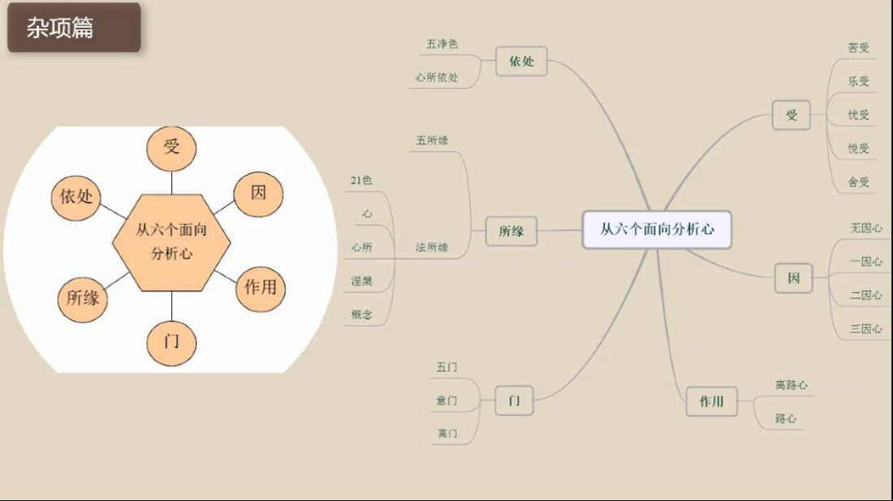

<div align="right">📅 最近更新：2026-10-14 17:14　|　第5版精修（朗读优化版）</div>

# 第1周：阿毗达摩总说与心法（主持人版）

> ⭐ **本讲主持人速览**（新主持人必读，2分钟看完）
>
> 你不是老师，是"共学同行者"。你不需要提前懂内容，只需要按流程走。
>
> **本周由连续两周内容合并**而成，含两段共读、两轮分享与两轮讨论，单讲 120 分钟。
>
> | 环节         |  标准时长  | ⏱ 时间不够→          | ⏱ 时间富余→   |
> | :--------- | :----: | :--------------- | :-------- |
> | 🧘 静心开场    | 10 min | 缩至5 min          | 加2分钟静坐    |
> | 📖 共读原文1   | 20 min | 只读★核心段（约15 min）  | 加读◈扩展段    |
> | 💬 第一轮分享   | 10 min | 每人1句话            | 每人3分钟     |
> | 🎯 第一轮主题讨论 | 10 min | 只讨论问题①           | 讨论全部问题+扩展 |
> | 🧘 禅修练习    | 15 min | 缩至8 min（只念引导词前半） | 延长至20 min |
> | 📖 共读原文2   | 20 min | 只读★核心段           | 加读◈扩展段    |
> | 💬 第二轮分享   | 10 min | 每人1句话            | 每人3分钟     |
> | 🎯 第二轮主题讨论 | 10 min | 只讨论问题①           | 讨论全部问题+扩展 |
> | 🔚 收尾与回向   | 15 min | 缩至10 min         | 保持        |
>
> **主持人10条守则（精简版）**：
>
> ① 不讲解、不提供答案——让原文自己说话；② 有人问"正确答案"→说"先听听大家的看法"；③ 冷场→主持人先分享自己的真实感受；④ 跑题→温和拉回："这个有意思，我们回到今天的原文"；⑤ 争论→"两种看法都很好，大家保留自己的理解"；⑥ 确保人人发言；⑦ 不评判任何人的分享；⑧ 时间到了就推进；⑨ 禅修练习照读引导词即可；⑩ 结束一起回向。

> 本周主题：**阿毗达摩总说（四种究竟法）与心法（89 心分类）**。

---

## 📋 本周信息卡

| 项目   | 内容                                                                                                                                                                                          |
| :--- | :------------------------------------------------------------------------------------------------------------------------------------------------------------------------------------------ |
| 时长   | 120分钟（4周版 · 9环节）                                                                                                                                                                            |
| 核心问题 | 阿毗达摩是什么、为什么被称为"殊胜的法"？四种究竟法（心、心所、色、涅槃）到底在说什么？学习阿毗达摩对我们的生活修行有什么真实意义？；什么是"心"？为什么把它分成 89 心（开为 121 心）？善／不善／无记与四界（欲界／色界／无色界／出世间）两张分类网，如何帮我们认识自己的心？                                                |
| 共读原文 | 共读原文1：材料①《如来禅修学体系34-阿毗达摩概要总说1》。　｜　共读原文2：材料①《如来禅修学体系41-摄心分别3》、材料②《如来禅修学体系48-摄杂分别4&摄心所分别1》。                                                                                                   |
| 本周作业 | ①简答题：请用你自己的话，说出"四种究竟法"分别是哪四种，各举一个生活中的例子。②实践题：本周任选一个烦恼（如对某人挥之不去的反感），试着观察它是"落在哪个所缘上"，并按材料①的提示"把它打个包、扔出去"，记录当下心有没有松一点。；①简答题：用一句话说说"心"和"四界心"的关系；②实践题：一天中留三次"观心"，记下此刻的心偏向善、不善还是无记，不必评判对错，只作诚实记录。 |

## 🗺 本周知识地图

```
阿毗达摩基础·四种究竟法与生活应用
│
├─ 一、阿毗达摩总说——殊胜的法（4W1 上半 ＝ 8W1）
│   ├─ 名与义：阿毗 abhi＝超越·殊胜；达摩 dhamma＝究竟真实的法
│   ├─ 即论藏：七部论；对教法作精确、系统的分类与诠释
│   ├─ 三藏定位：律藏（行为规范）·经藏（言行录）·论藏（修行指导手册）
│   ├─ 经教法 vs 论教法：经教随根器方便说「人」；论教直说胜义谛
│   ├─ 概念法 vs 胜义谛：人我众生＝概念法；论教直解构之
│   └─ 三种密集：相续密集 · 组合密集 · 功用密集
│
└─ 二、心法——89 心与 121 心（4W1 下半 ＝ 8W2）
    ├─ 心＝识知所缘，「纯粹只是识知的过程」，其中无造作者之「我」
    ├─ 心的六面向：依处 · 所缘 · 受 · 因 · 作用 · 门
    ├─ 两张分类网：界（欲 54／色 15／无色 12／出世 8）· 本性（善／不善／无记）
    ├─ 89 → 121：出世间 8 心开为 40（乘五禅那），89＋32＝121
    └─ 学习重点：把 89 心看成一张分类地图，不逐格读表
```

**本周要点**

1. 「阿毗达摩」＝「殊胜的法」，殊胜不是更高级，而是处理方式不同、更精准。
2. 论教法直说胜义谛，解构「人我众生」的概念法。
3. 四种究竟法：心 · 心所 · 色 · 涅槃；学它不在背诵，而在有抓手。
4. 心＝识知所缘、「纯粹只是识知的过程」，没有造作者／工具的「我」。
5. 看心的六面向：依处 · 所缘 · 受 · 因 · 作用 · 门。
6. 两张大分类网：界（欲 54／色 15／无色 12／出世 8）· 本性（善／不善／无记）；出世间 8 心开为 40，故 89 → 121。

📌 来源：`知识框架与要点/读书会14_阿毗达摩基础_知识框架与要点.md` → 「三、4周版 · 4W1」

## 🧘 静心开场（10 min）

> 💬 **破冰｜3–5分钟**：今天有没有哪一刻，你忽然发现「自己其实没在听」——眼睛在，心不在？一句话说说那个瞬间，说完就放下。

> 🛡️ **心理安全三约定**（每次开场在心里过一遍）：① **保密**——这里说的话不出这间屋子；② **不评判**——不评价任何人的分享，也不急着评价自己；③ **可随时暂停**——任何时候觉得不舒服，都可以停下来休息、喝水或离开，不需要解释。

**（主持人引导语，语速放缓，每句之间留白）**

> 各位法友，请找一个让自己舒适的坐姿，可以盘腿，也可以坐在椅子上。轻轻闭上眼睛，或者让视线柔柔地落在前方地面。先做三次深长的呼吸——吸气，慢慢地；呼气，也慢慢地。
>
> 现在，把注意力带到身体。感觉一下此刻的坐姿，感觉身体与坐垫接触的地方，感觉双手放着的温度。不需要改变什么，只是知道。
>
> 接着，把注意力放到呼吸上。知道吸气，知道呼气。不去控制呼吸，只是陪伴它。吸气进来，呼气出去……如果心跑开了，不要责备它，轻轻地把它带回来，再回到呼吸。
>
> 现在，我们来练习一会儿慈心。先想到自己，在心里轻轻地对自己说：愿我健康，愿我快乐，愿我平安，愿我远离痛苦。把这份善意，送给坐在你左右的每一位法友——愿他们健康，愿他们快乐，愿他们平安。
>
> 再把它扩大一些，送给我们今天要学习的法——愿我们听得明白，愿法义入心，愿所学能真正用在生活里。也送给那些一想到"阿毗达摩很难"就有点紧张的心——愿它放松，愿它知道，听不懂也没关系，我们一次听一点就好。
>
> 好，保持这份开放与柔和，我们慢慢睁开眼睛，回到当下。带着这份宁静，我们一起进入今天的共读。

**（主持人操作）** 开场控制在 10 分钟内。若学员入场慢，可先让早到者安静就坐，准点再开始引导。静心不作"必须静下来"的高压要求，语气始终作邀请。本周特别在慈心段加入"对怕难的心也送一份善意"，为全课定下调子。

## 📖 共读原文1（20 min）

> ⚠️ **主持人操作**：共读原文只读不解释。本节由一位熟悉阿毗达摩的法友朗读。读到生僻术语，主持人用一句话白话点明（例如"究竟法＝真实到不能再分的法""胜义谛＝直接讲心与色，不讲人我"），不展开。时间不够时，只读"（一）阿毗达摩之名与定义""（二）三藏定位"两段，其余作课后阅读。

### 原文材料①：★核心·阿毗达摩概要总说1（如来禅修学体系34）

- **文件**：《如来禅修学体系34-阿毗达摩概要总说1-古源尊者-20250205》

> ⚠️ 主持人操作：音声材料，保留时间码供选读定位。建议（一）～（四）四节全文照读。正文括注（ ）内为整理注记，朗读时跳过。

#### 一、阿毗达摩之名与定义

它是阿毗达摩藏。什么是？巴利叫 Abhidhamma（阿毗达摩）。*abhi* 的意思，是超越、殊胜的意思；*dhamma*，我们过去翻译成"达摩"，是法的意思。那么阿毗达摩里面的这个 *dhamma*，在这里主要是指究竟真实的教法，特别指佛陀所教导的法。*dhamma* 在巴利语词源学里面，它的涵括很广，一切的事物现象，都可以被称为法。

我们经常讲"世间万法"。但是阿毗达摩里面的这个法，它主要是指佛陀教导的、究竟法层面上的内容；那阿毗达摩，也是三藏里面的论藏，或者称为阿毗达摩藏。

### 二、三藏定位：律藏、经藏、论藏与七部论

那论藏，是对佛陀的教法给予精确的、系统的分类和诠释，总共有七部论。我们前面就给大家讲过：

**律藏**，是世尊给比库们制定的戒律、教诫和生活规则，它其实是一种生活指导手册。

**经藏**，是佛陀和圣弟子的言行录——佛陀讲法四十五年，他的言行录。那么**论藏**，是对佛陀的教法给予精确、系统的分类和诠释，包括法集论等，它有七部论——法集论、分别论、界论、人施设论、论事论、双论和发趣论。

如果说律藏是佛弟子的行为规范，那么论藏，就是我们佛弟子的修行指导手册。虽然，在整理的时候，它有很多这种排列性的这种组合，但是实际修的时候，这些所有的内容都是要去修它的，在直观的方面，我们都要去修它的。

### 三、经教法与论教法

在佛陀的教法里面，分成两大类：一类称为经教法，一类称为论教法。那么经教法，是佛陀在证悟以后教化众多弟子的言行集。

佛陀在说法度众的四十五年时间里面，有时候在精舍说法，有时候在托钵的时候说法，有时候是在游行中说法；有些时候，是基于大悲心观察到，有一些众生的根性成熟了，他可以得到法的利益，他就会用各种形式，不管是以游行的方式还是神通的方式去度化他。根据不同听众的不同根基，在不同的场合下，随机缘而教导。

所以我们往往经常会看到，经典都是说"如是我闻，一时，佛陀在什么样的地方，当时是一群什么样的人"，然后这个就是讲他的因缘。那么标准来这个来讲，那我们讲经说法呢，就从经题开始，一路从"如是我闻、一时世尊在舍卫城祇树给孤独园于其处，这个谁谁谁如何"。这样的过程，它就是这样的一种形容，就是讲这个佛陀随众生的根器，在不同的场合、不同因缘的一个教导。

往往，我们在经典里面看到都是佛陀讲完一部经，然后最后那一部分就会讲：那个时候多少众生就证得了法眼净，多少多少众生就灭苦了，多少多少众生真的证得二果三果四果了。每一次讲法都有很多众生得到世间的利益，尤其是很多天众。那这些，我们一般称为佛陀讲法之后的当机众。

举个例子：佛陀证悟以后讲的第一部经《转法轮经》，那个时候的当机众只有五个比库，就是五比丘，以衮丹雅（阿若憍陈如）为首的五比丘。《转法轮经》讲完以后，只有衮丹雅尊者证得初果。但是根据注释书里面说，听法的天众，有无量无边的天人证得初果二果三果四果。

所以佛陀在这里讲的法，听众包括人和天在内，针对性很强，他并不是系统地、完整地去把佛陀所证悟的法都阐释出来。他不是讲说"我以我跟奉证了多少法，我现在来跟你讲一遍"——在经典里面佛陀不是这样讲的，它是针对性很明确的，说完就要让听众解决他们的问题。那么这种说法方式，就是经教法，它们被收集起来、被整理出来，形成这样的一个言行录，那类似于佛陀的语录，我们称为经藏。那经教法，又被称为叫方便的法说，或者说受到装饰的教法。

佛陀在讲法的过程中，他使用很多的比喻，为了大家明白，他并不是直接从究竟法——大部分时间，不是从究竟法的角度来讲，而是通过世俗方面的举例、比喻，来让大家更好地明白和理解。那这个，就被称为方便说法。那受到装饰的教法，是说佛陀特别能讲故事、特别能够比喻。我们看经典，佛陀有很多这样的比喻，让人一看就能明白。

而论教法，它是不一样的。它指的是佛陀在证悟后的第七个雨安居，他来到三十三天，给当时他出生后没几天就去世的母亲——这个母亲在三十三天结生为男性天子——以他作为当机众。但是同时，有十万个轮回世界的天人，一起来听。

### 四、论教法探讨胜义谛与三种密集

佛陀在天界讲了三个月，系统、完整地把他证悟的这个法，跟天人说了一遍。论教法探讨的是胜义谛。胜义谛，是直接对世俗谛的概念进行解构，破除人、我、众生的这个概念密集。我们经常讲说人、我、众生，它是概念化的世俗谛；而我们讲的密集，简单来说就是这个概念法的不同方式、不同角度的组合。

从现代医学的角度上来讲，我们人体是由很多细胞组成的。从医学角度上来看，细胞的寿命是很短的，细胞也快速地生成代谢，没有一个细胞是从我们出生到死亡一直存在的。从这个角度上来讲，其实现代医学也认为，生命里面的物质是一直在生、一直在灭的，并没有一个不变的细胞，这是变化的。但是，我们并不能看见细胞的情况，为什么看不见呢？那是因为我们肉眼的能力无法达到，要借助显微镜才能看到；单凭肉眼，是没有办法看到分子、甚至于原子的运行状态和生命的过程。

对此，佛教里面有一个专门的名词，就称为密集。看不清楚生命的物质现象和精神现象的根本组成和运转状态，我们把它称为密集。那从色法的角度来讲，它有三种密集，就是相续密集、功用密集和组合密集。

**相续密集，** 很容易理解，就像放电影。现在放电影的速度，每秒钟是二十五帧，我们去看它的时候就感觉看真实世界一样。然而，我们色法或者色聚的生灭速度，要远快于放电影，一秒钟，大家都说是亿万次的生命，这是一个大致的数字，因为没有办法去计算。但因为这样的一个快速生灭的状态，所以看过去好像根本没什么变化。我们看一个人，看一个人现在，然后从开始禅修到现在结束，你都还是那个样子，你就不觉得他有什么变化。

也就是我们看一个人的这一刻跟下一刻好像没有变化一样，今天和明天，你也看不到什么变化，这个月跟下个月没什么变化。但是如果你隔了十年再看，你就觉得，哦，还是有点变化，你要足够长的时间才能看出来。那么这样的一种看不到这种密集效用，我们称为叫做相续密集。你这个相续过程的生命，我们看不见，好像是一个不变的东西，你的相续密集。

**另外一个密集，叫做功用密集。** 功用密集，是讲功能不同。那么，眼睛为什么可以看东西呢？这个就属于功用密集。从色法角度上来讲，地水火风是基础。那么，地大有地大的功用，水大有水大的功用，火大有火大的功用……

**【◈扩展·组合密集：身体为什么看起来是一个整体】**

**第三个密集，叫做组合密集。**

组合密集，是以色法作为组合内容的一种密集。在这种密集的作用下，我们的身体看过去就像一个整体的形态出现。学过解剖学的人，观察人体的时候就会发现里面有骨头，有筋腱。

我们这个修习三十二身分的人，一般我们给的业处就是修修习三十二身分。如果定力能够维持到三个小时以上、没有妄念，大部分同学看自己的身体就像放在眼前看一样，甚至可以深入到身体的每一个器官——深入到肝脏里面看有没有结节，深入到胆囊里面看有没有结石，深入到肾脏里面看有没有囊肿，电力够的话都是可以看的。可是，如果没有这样的密集破除，我们就看不见，我们只能看到「你这样一个人」。

在阿毗达摩的角度，不单要修习三十二身分，后面还要依次分解到色聚。破除色聚的密集之前，任何一个色聚都有八不离色——地、水、火、风、色、香、味、食素这八种色法。人的身体是由无数个色聚聚合而成的；我们没有能力破除组合密集的时候，就看不到它的组成。

所以会有「人、我、众生」这种概念，是因为它们被这三种密集遮盖了——我们看不见。阿毗达摩要做的，就是在破除密集以后，对这些概念进行解构，一直解构到如实知见物质和精神世界的基本属性、它们的成因，以及它们之间的联系。

为什么上座部不认同「极微」这个说法呢？一切有部有个词叫极微，但在上座部的阿毗达摩里，没有极微。如果硬要拿极微来对照，之前最小的色法聚合体就叫色聚——因为这个色聚还没有破除它的组合密集、功用密集、相续密集，所以它还是一个「聚」的存在。当密集被破除以后，物质世界——包括我们人和外在的一切物质——最基本的东西，剩下的是我们称为「属性」，而不是一个粒子、一个有空间大小有体积的粒子存在。究竟色法不再是这样一种概念，而是一种属性。

### 原文材料②（◈扩展）：◈主材料·摄阿毗达摩义论表解（究竟法之定义与四究竟法分类）

- **文件**：《摄阿毗达摩义论表解-简体-完整版201802》

**【◈扩展·究竟法与四个鉴别法：特相·作用·现起·近因】**

「究竟法」是指：依各自的自性存在且不可再被分解的法。经教有时也会提到「性相」，即：名法与色法各别的「自相」(自性)，与无常、苦、无我的「共相」；阿毘达摩论及「性相」时，则更加专精，甚至达到深邃见底的程度，所以有所谓的「阿毘达磨性相所显」之说。

某些派系使用「体(性)、相(特相)、用(作用)」来诠释法义；阿毘达摩则从「特相、作用、现起（呈现），及近因」四个鉴别法来解说究竟法。

**【◈扩展·四种究竟法：心·心所·色·涅槃】**

在经教中，佛陀经常将究竟法归纳为五大类，即：色蕴、受蕴、想蕴、行蕴与识蕴；阿毘达摩则将究竟法（胜义法）归纳为四大类，即：心（cittaṁ）、心所（cetasikaṁ）、色（rūpaṁ）与涅盘（nibbānaṁ）。其中，阿毘达摩的二十八「色」相当于经教的「色蕴」，「受心所」相当于经教的「受蕴」，「想心所」相当于经教的「想蕴」，「五十心所」（52 心所扣除「想心所」与「受心所」之后的其余五十心所）相当于经教的「行蕴」，「心」相当于经教的「识蕴」； 这些究竟法都是「有为法、因缘和合所生法、生灭法」。至于阿毘达摩的第四种究竟法－－「涅盘」，则是「无为法、非因缘和合所生法、非名色法、非生灭法」，它不属于任何一蕴。

## 💬 第一轮分享（10 min）

**分享规则**

- 以自愿为限，先邀请、不点名；每人约 2 分钟，主持人以"90 秒牌"轻控时。
- 只听不评判：不打分、不比较、不纠错，别人说到与你理解不同处，也先放一放。
- 若无人开口，主持人可用一句话自曝："我第一次听到'四种究竟法'时，也完全摸不着头脑"，先破冰。

**起手问题（任选 2–3 个，结合本周主题与生活经验）**

1. 用一句话说：在你听到这门课名字之前，你心里觉得"阿毗达摩"是什么？现在听完共读，它变成了什么？
2. 材料①里说"阿毗达摩是修行实践手册，不是要背的哲学"。你在生活里，有没有哪一件事，是"用一句法真的把心转过来"了的？说说那一次。
3. "万法"这个词你一定听过。听完"四种究竟法"，你更愿意把日常挂在嘴边的哪些词（如"我""他""气氛""关系"）看成"概念法"？这对你面对情绪有什么帮助？

## 🎯 第一轮主题讨论（10 min）

> **分层追问**（可视时间取用，由浅入深）：
>
> - 【现象】心、心所、色、涅槃这四种究竟法里，哪一个是你第一次听到、却觉得最贴近自己的？
> - 【影响】如果「心」只是清清楚楚地知道眼前的东西，那今天你真正「知道」的时刻，多还是滑过去的多？
> - 【应对】这一周，每天找三次「回到当下」的机会——一次呼吸、一口水、一步路，看看那一刻心里有什么。

> ⚠️ 主持人操作：三题由浅入深，先让学员用生活语言回答，再回扣原文。每题先 3 分钟小组/邻座互说，再全体发言。不追求结论，允许"带疑问继续学"。

**问题一：为什么阿毗达摩被称为"殊胜的法"？这个"殊胜"殊胜在哪里？**

- 提示：请学员回到两个关键词——"阿毗＝超越、殊胜""究竟法"。引导从三处找答案：（1）法义层面，它从"直接的方式"讲究竟法，不讲人我众生（材料②"经典与阿毘达摩对法义论述方式的异同"）；（2）作用层面，它把散在经藏中的教法"系统完整地整理出来"（材料①系统了解教法）；（3）态度层面，"殊胜"不是"更高级"，而是"处理方式不同、更精准"（材料③戒喜："不是说阿毗达摩的教法比经藏更好，而是说就处理方法而言")。提示学员：不要把"殊胜"理解成"我学了就比别人高"。

**问题二：四种究竟法（心、心所、色、涅槃）与我们每天的生活有什么关系？**

- 提示：先请学员各举一个"生活里的四种究竟法"的例子——比如"我知道我在生气"里的"知道"是心、"生气"本身是心所、"生气时胸口发紧"是色法、"气消了的那份清凉"接近涅槃（在此只作近似比喻，不作玄谈）。再引材料③戒喜"四圣谛包含在四种究竟法里"的归纳：苦谛＝部分心、心所、色；集谛＝贪心所；灭谛＝涅槃；道谛＝八个心所。让学员看到：原来"苦集灭道"不是抽象口号，而是"我当下这颗心"的结构。**提示**：此问涉"无我、涅槃"深义，学员困惑时不强行解释，强调"带疑问继续学习"。

**问题三：材料①说"学了阿毗达摩，生活修行就有抓手"。请具体说说，你打算从哪里"下手"？**

- 提示：引材料①尊者最实用的几句——"我教的阿毗达摩从来不要求人家背，每堂听完能用上一句就好""你就发现生活修行就有抓手""解脱就可以在每个当下发生"。请学员就本周作业里的那一个具体烦恼（挥之不去的反感、反复冒出的焦虑）说一步：我是先"如实看见它落在哪个所缘上"，还是先"把它打个包、扔出去、重新起一条路"？引导把"道理"变成"本周做得到的一件小事"。

## 🧘 禅修练习（15 min）

### 练习一

> ⚠️ **禅修禁忌提示**：若你正处在严重抑郁、焦虑、创伤后应激，或精神类疾病的发作／用药期，或正经历强烈的情绪危机，请先咨询医生或心理师，再决定是否练习；练习中若出现明显不适（如心悸、胸闷、情绪失控），请立即停止，睁开眼睛，把注意力放回呼吸与身体，必要时离场休息。

**（本周练习：入出息念＋对所缘的"如实观察"，主持人引导词，照读即可）**

> 各位法友，请坐好，身体放松，肩膀自然下沉。轻轻闭上眼睛，把注意力放到呼吸上——只是知道呼吸本来的样子，不去调整它。
>
> 吸气，知道；呼气，知道。当心跑开时，不要责备自己，只是轻轻地带回来。你会发现，心总是会跑——跑了，带回，跑了，带回。这本身就是最真实的"心的运作"，阿毗达摩讲的就是它。
>
> 现在，如果在呼吸之外，有个念头、有个情绪一直往上冒——也许是今天没放下的一件小事——不要赶它走。只是看着它：它是一个"所缘"，心落在这件事上了。材料里尊者说，所缘有个隐秘的本事，会把你"迷"在里面、粘在上面；我们不跟它转，也不跟它斗，只是看着它。
>
> 如果它还在，就在心里轻轻说一句："我看见你了。"然后，像把一件旧衣服叠好、放下一样，把注意力重新带回呼吸这一条新的路。你会感觉到，绕在上面的那个循环，被轻轻地打断了。
>
> 好，我们在呼吸里安静地坐一会儿……（留白 2–3 分钟）
>
> 慢慢把觉知带回身体，回到坐垫、回到呼吸、回到此刻。慢慢睁开眼睛。


**（主持人操作）** 15 分钟：引导约 5 分钟＋静坐 7 分钟＋收束 3 分钟。若时间富余，可加 5 分钟"四界差别观"引子——只作概念性引导（"感受身内的坚、湿、暖、动"），**并明确提示：四界差别观须有定力基础，量力而行，身体不适以放松为先**。若有人练习中情绪起伏，请其先做三次深呼吸，必要时可暂离、喝水。

### 练习二

> ⚠️ **禅修禁忌提示**：若你正处在严重抑郁、焦虑、创伤后应激，或精神类疾病的发作／用药期，或正经历强烈的情绪危机，请先咨询医生或心理师，再决定是否练习；练习中若出现明显不适（如心悸、胸闷、情绪失控），请立即停止，睁开眼睛，把注意力放回呼吸与身体，必要时离场休息。

**（本周练习引导词：观心三态，照读即可）**

> 接下来的十五分钟，我们先让身体安定，再让心安定，然后——只是"看"。

> 好，请大家再次调整坐姿，轻轻闭上眼睛，做三次自然的呼吸。
>
> 现在，我们把今天学的，用来做一件很简单的事——**观心**。
>
> 不是观察呼吸，也不是观察身体，只是轻轻地"知道"：此刻的心，是什么状态？
>
> 如果此刻心里有一点贪——想要、想抓、想再听一句、想再刷一下——轻轻地知道："哦，这是贪。"
>
> 如果此刻心里有一点嗔——不满、烦躁、讨厌、不耐烦——轻轻地知道："哦，这是嗔。"
>
> 如果此刻心里既不贪也不嗔，只是平平淡淡的、习惯性的——轻轻地知道："哦，这是无记。"
>
> 不去改变它，不去批判它，不与它对抗。只是知道，然后放它走。心会再变，你就再知道。
>
> 再进一步，试着感受：在这"知道"的背后，有一个永恒不变、可以称之为"我"的东西吗？还是——知道的，也一直在变？
>
> 不需要回答。只是看看。
>
> 好，慢慢把注意力带回身体，带回呼吸，睁开眼睛，回到当下。

**（第二段·可选，时间富余时做：四界心的层次感受）**

> 让我们再试一个很轻的练习。先把注意力放到"刚刚那一念"——你刚才想起了什么？也许是一个计划、一个人、一句话。轻轻地问自己：这一念，是"粗"的，还是"细"的？
>
> 如果它是散乱的、到处跑的、跟着欲望追的——它偏"欲界"。如果它是专注的、安静的、只是清清楚楚地知道一个对象——它偏"色界"的方向。如果它连对象都淡了，只剩一片清明的安静——那是"无色界"的方向。如果这一念转为"看清无常、不再执取"——那是"出世间"的种子。
>
> 不需要读懂，也不需要评价高下。只是体会：原来心的"层次"，就在这一念之间起落。

**（主持人操作）** 练习中语气极缓，留白要足。结束时提醒：观心不是"控制心变好"，而是"如实知道此刻的心"。若有人练习中情绪波动，引导其先回到呼吸、放松身体，不勉强深入；第二段"层次感受"为可选项，若学员已显疲累则省略，直接收束。

## 📖 共读原文2（20 min）

> ⚠️ **主持人操作**：共读原文只读不解释。建议分工朗读：材料①由一位熟悉阿毗达摩的法友读，材料②由另一位读。读到生僻术语，主持人用一句话白话点明（例如"无因心＝没有贪嗔痴也没有无贪无嗔无痴的心"），不展开。时间不够时，材料①只读"礼敬佛陀"与图，材料②只读"心的六面向"，其余作课后阅读。

> 主持人：若时间极紧，可只读材料②"心的六面向"与 89 心分类的三条线索（界／本性／因），其余全部转为课后阅读；宁可留足分享与讨论的时间，也不要把课堂变成一场朗读会。读得少、想得多，往往比读得多、想得少更受益。

### 原文材料①：★核心·心的定义与特相／89心与121心明细表

- **文件**：《如来禅修学体系41-摄心分别3-古源尊者-20250212（课件）》

**【◈扩展·八十九心分类简表：造业心 33・非造业心 56】**

八十九心，依本性与界而分类，可分为造业心三十三种，与非造业心（无记心）五十六种，共八十九心。

**造业心三十三种**，分为不善心与善心两类。不善心有因，共十二种，皆属欲界；善心有因，共二十一种。

**非造业心（无记心）五十六种**，分为果报心与唯作心两类。果报心三十六种，唯作心二十种。

就八十一世间心而言：欲界心共五十四种，其中不善心十二种，善心八种，果报心中有因者八种、无因者十五种（即七种不善果报加八种善果报），唯作心中有因者八种、无因者三种。色界心共十五种，无有不善心，善心五种，果报心五种，唯作心五种。无色界心共十二种，无有不善心，善心四种，果报心四种，唯作心四种。

出世间心共八种，善心（道心）四种，果报心（果心）四种，没有唯作心。

合而计之：不善心十二种，善心二十一种，果报心三十六种，唯作心二十种，共计八十九心。

### 原文材料②：89心分类总览／欲界色界无色界出世间四界心

- **文件**：《如来禅修学体系48-摄杂分别4&摄心所分别1-古源尊者-20250223（课件）》

> ⚠️ 主持人操作：本节提供"心的六面向"与"89心分类"总览，信息量大。原课件为表格图形页，文字层 OCR 多乱码（如"喷头"应为"嗔心"、"无食醋液"应为"无贪无嗔无痴"），故表格改以条目与图呈现；朗读时只念条目与结构，表格式记忆留作课后。

#### 一、心的六面向

从六个面向来分析心：

- **依处**：五净色、心所依处
- **所缘**：五所缘、法所缘（法所缘含 21 色、心、心所、涅槃、概念）
- **受**：苦受、乐受、忧受、悦受、舍受
- **因**：无因心、一因心、二因心、三因心
- **作用**：离路心、路心
- **门**：五门、意门、离门



> 主持人：这六面向就是"看心的六副眼镜"——依处、所缘、受、因、作用、门。今天记住这六副眼镜，比记住 89 个数字更有用。

#### 三、八十九心（与121心）分类

**欲界心 54**

- 十二不善心：
  - 贪根 8：悦俱·邪见相应·无行、悦俱·邪见相应·有行、悦俱·邪见不相应·无行、悦俱·邪见不相应·有行、舍俱·邪见相应·无行、舍俱·邪见相应·有行、舍俱·邪见不相应·无行、舍俱·邪见不相应·有行
  - 嗔根 2：忧俱·嗔恚相应·无行、忧俱·嗔恚相应·有行
  - 痴根 2：舍俱·疑相应、舍俱·掉举相应
- 十八无因心：
  - 不善果报 7：舍俱眼识、舍俱耳识、舍俱鼻识、舍俱舌识、苦俱身识、舍俱领受（意界）、舍俱推度（意识界）
  - 善果报 8：舍俱眼识、舍俱耳识、舍俱鼻识、舍俱舌识、乐俱身识、舍俱领受（意界）、舍俱推度（意识界）、悦俱推度（意识界）
  - 无因唯作 3：舍俱五门转向（意界）、舍俱意门转向（意识界）、悦俱阿罗汉生笑心（意识界）
- 二十四美心：
  - 欲界善心 8：悦俱·智相应·无行、悦俱·智相应·有行、悦俱·智不相应·无行、悦俱·智不相应·有行、舍俱·智相应·无行、舍俱·智相应·有行、舍俱·智不相应·无行、舍俱·智不相应·有行
  - 欲界果报心 8：同八种（悦俱／舍俱 × 智相应／不相应 × 无行／有行）
  - 欲界唯作心 8：同八种（悦俱／舍俱 × 智相应／不相应 × 无行／有行）

**色界心 15**

- 初禅、第二禅、第三禅、第四禅、第五禅，各具善心、果报心、唯作心，共 15。

**无色界心 12**

- 空无边处、识无边处、无所有处、非想非非想处，各具善心、果报心、唯作心，共 12。

**出世间心 8**

- 四道心：须陀洹（入流）道心、斯陀含（一来）道心、阿那含（不来）道心、阿罗汉道心
- 四果心：须陀洹果心、斯陀含果心、阿那含果心、阿罗汉果心

合计 54＋15＋12＋8＝89；出世间 8 心于五禅处开为 40，即 121 心。

**【◈扩展·色界五善心的寻伺喜乐】**

色界心共有十五种，分为善心、果报心、唯作心三组，每组五种。色界的五种善心，依禅支的差别而区分，共有五个层次：

**第一，初禅善心。** 具足五种禅支——寻、伺、喜、乐、一境性。随着禅定的进展，禅支依次舍弃而降减。

**第二，第二禅善心。** 舍去"寻"，保留伺、喜、乐、一境性四种禅支。

**第三，第三禅善心。** 更舍去"伺"，只保留喜、乐、一境性三种禅支。

**第四，第四禅善心。** 再舍去"喜"，只保留乐、一境性两种禅支。

**第五，第五禅善心。** 最后以"舍受"取代"乐受"，只保留舍、一境性两种禅支。

因此，五禅支由粗到细，逐层舍弃：初禅有寻、伺、喜、乐、一境性；第二禅为伺、喜、乐、一境性；第三禅为喜、乐、一境性；第四禅为乐、一境性；第五禅则以舍、一境性为其禅支

### 原文材料③（◈扩展）：八十九心分类表——依「本性」／依「因」分类与名词解释

- **文件**：《摄阿毗达摩义论表解-简体-完整版201802》

> ⚠️ 主持人操作：本段是「89 心为何是 89、121」的两张分类网（界／本性／因）的原文依据，时间富余时加读。朗读顺序：先依「界」四句（一读），再依「本性」四类（二读），再依「因」有因／无因（三读），最后读偈颂收束。名词解释只挑三两条点一句白话（如「异熟＝果报」「美因心＝善心」「意识界＝扣除双五识与意界后的 76 心」），不逐条念。表中「|」与「--」照读为「格」与「无」即可。若时间极紧，本段整段转课后阅读，不影响本节六面向与四界心的主线。

**【◈扩展·依「本性」与依「因」分类：十二不善心・二十一善心・三十六果报心・二十唯作心】**

二. 依「本性」(jati)分类, 心有四类(ch.1-1的简表, 由上而下对照):

【不善心】12个：贪根（8个）、瞋根（2个）、痴根（2个）。

【善 心】21个：欲界（8个）、色界（5个）、无色界（4个）、出世间（道心4个）。

【果报心】(又名异熟心)36个,分两类:「无因果报心」(欲界才有)与「有因果报心」。「无因果报心」又可分为「(无因)不善果报心」与「(无因)善果报心」。「不善果报心」(7个)是过去不善业引生的不善果报,所缘是不可喜的;「善果报心」(8个)是过去善业引生的善果报,所缘是可喜或极可喜的。「有因果报心」于欲界(8个)、色界(5个)、无色界(4个)、出世间(果心4个)。

【唯作心】20个：欲界（无因3个，有因8个）、色界（5个）、无色界（4个）、无色界（4个）。

$\star$「善心」与「不善心」是「主动造业」的心，会留下业的潜力，引生未来相对应的善或不善果报。

「果报心」是「被动受业报」的心，是过去所造的善或不善业成熟而引生的相对应果报，换言之，它是体验成熟之业的心。

「唯作心」是既非造业的心，亦非受业报的果报心，只执行心的作用而已。除了两个欲界无因唯作心（转向心）是凡圣共有之外，其余皆是阿罗汉特有的心。

※ 善果报心、不善果报心与唯作心皆为「无记」。

三. 依「因」(hetu)分类,心有两类:「有因心」与「无因心」

【有因心】是指心有「贪.瞋.痴」三不善因，或「无贪.无瞋.无痴」三美因。

【无因心】是指心既无「贪.瞋.痴」三不善因，亦无「无贪.无瞋.无痴」三美因。

无因心有18心（含15果报心与3唯作心），其余71心则皆是有因心。

（补充说明）

1. 欲善果报心有两类：「无因善果报心」（与无因不善果报心执行相同作用）及「(无因)善果报心」(原文前文作8无因善果报心)，虽同样各有8个，但各自执行不同的作用（见〈第三品〉摄作用）。
2. 欲界有因心、色界心与无色界心，各有三组名称相同的善心、果报心、唯作心。
3. 「不善心」、「不善果报心」及「无因心」皆只出现于欲界心。
4. 造业的善心与不善心都是有因心，无记的果报心与唯作心则各分无因与有因两种。

**【◈扩展·有因心 71 与美因心 59 的算法】**

- 71 有因心=89心-18无因心(7不善果报+8善果报+3唯作)
- 59 美因心=89心-12不善心-18无因心

**【◈扩展·名词解释摘录：界・色界心・无色界心・出世间心・意识界・唯作心】**

﹝《摄阿毘达摩义论》1论文 2及名词解释﹞（摘录相关分类定义）

〔界〕（avacara）是心经常活动或往返之处。分类为：欲界心、色界心、无色界心。

〔色界心〕（rūpāvacaracitta）：最常出现于色地的心。

〔无色界心〕（arūpāvacaracitta）：是最常出现于无色地的心。

〔出世间心〕（lokuttaracitta）：缘取涅盘为所缘的心称为「出世间心」。

〔不善心〕（akusalacitta）：是造不善业的心。

〔五识界〕是双五识，唯以五境为所缘。

〔意识界〕(manoviññāṇadhātu)89 心中，扣除双五识(10 个)与意界(3 个)后，其余 76 心是意识界。

〔推度心〕（santiraṇa）：推度（考察）该印记。

〔异熟心〕(vipāka)：又名果报心。

〔五门转向心〕（pañcadvārāvajjana）：转向心之一。

〔意门转向心〕（manodvārāvajjana）：当法所缘呈现于意门时，把心转向该所缘的是「意门转向心」。

〔生笑心〕（hasituppāda-citta）：只有佛或阿罗汉微笑时才会生起。

**【◈扩展·八十九与一百二十一之由来（原文偈颂）】**

欲界有因心(或美心)分三组: 8大善心、8大果报心、8大唯作心。

由于四道别，故善心有四，十二不善心，善心二十一，欲界五十四，色界心十五。如是应知意，区别八十九。

同彼异熟果，为无上八种。

三十六异熟，二十唯作心；

无色心十二，出世间八种；

智者再分别，一百二十一。

## 💬 第二轮分享（10 min）

**分享规则：** 自愿为限，每人 90 秒左右，主持人控时。先请一位法友起头，其余依次；允许沉默，不点名强制。分享只讲"我自己的体会"，不评判他人。

**起手问题（任选 2—3 个）：**

1. 听到"八十九种心"时，你的第一反应是什么？（头大？好奇？还是"跟我有什么关系"？）现在再看这张地图，感受有没有变化？
2. 回看今天：你有没有闪过一个"不善心"（贪、嗔、痴、掉举）？又有没有一个"善心"（想帮人、想学习、想安静）？不需要说出具体内容，只说"我认出它了"。
3. 用最朴素的话说：你觉得"心"是什么？它像一样什么东西？（像河水？像天空的云？像开关？）——把你的比喻说一说。
4. 今天听到的哪一句，是你最想带回家的？是"心只是识知所缘"，还是"89心不必全记"，还是"心一直在变"？——只挑一句即可。

> 主持人提示：第一轮是"破冰＋暖场"。若有人说"完全看不懂表"，请温和回应："今天不需要看懂表，你只要说出你的感受，就已经在'观心'了。"避免让名相把分享压成"考试"。若分享冷场，主持人可先讲一段自己"第一次看到 89 心时完全懵"的经历，通常能立刻融化僵局，让学员感到"原来大家一样"。

## 🎯 第二轮主题讨论（10 min）

**引导问题（由浅入深，指向实修）：**

**问题 1｜"心只是识知所缘"，这句话对你意味着什么？**

提示：心不是"我"，它只是"知道对象"的活动——看到红色，是眼识在知道；听到声音，是耳识在知道。可以请大家举一个刚刚发生的例子："刚才你'知道'了什么？"再问：那个"知道"一直在吗？还是刹那生灭？——引出"心是变化、无常的"。

**问题 2｜善心、不善心、无记心——一天当中，你的"无记心"占多少？**

提示：无记心＝既非善也非不善的心（果报心、唯作心，如习惯性动作、发呆、走路）。可请大家估算比例，再问：这与"正念"有什么关系？（正念不是把无记变善，而是**如实知道**当下是哪一种心。）由此引到"观心"的实修价值。可再补一问："你走路时、洗碗时、排队时，心多半在哪里？如果此刻能'知道'它，这个知道本身就是正念。"

**问题 3｜从"欲界心"到"出世间心"，你体会得到层次的差别吗？**

提示：不必谈禅那。用日常类比即可——散乱刷手机是"欲界"的粗状态，专注做事是"色界"的专注、微细状态，安住不动、对境不动的清明是"无色界"的方向，而"看清无常、朝向解脱"的一念是"出世间"的种子。问：哪一种状态你最近体验过？你希望更多地安住在哪一种？——引到"修行即是在心的层次上升进"。

**问题 4（弹性题）｜"记不住 89 心"这件事，你怎么看？**

提示：把"记不住"当作一个观察对象——它背后是焦急、是自责、还是放下？可问：如果 89 心真的不必全记，那我们今天"学会了什么"？（答案是：学会了"看心"的视角，而不是背下了分类。）由此收束到本讲的主旨：这张地图是用来"看"的，不是用来"背"的。此题适合时间富余或气氛较松时使用。

> 主持人提示：四题不必全开，时间不够时取前两题。讨论中若有人陷入"我是不是很坏"（把不善心当成道德判决），务必拉回："观察不是审判，认得出就是正念在运作。"若有人对"无我"发慌，不强行解释，说"这是好问题，带着它继续走。"若要控场，可在每题结束时用一句话小结，再引入下一题，避免讨论散漫。

**（可选）术语白话小抄（主持人随时可用）：**

- **心（citta）**：识知所缘——只是"知道"。不是灵魂、不是"我"。
- **89 心 / 121 心**：把心按"界＋本性＋因"分类的数目。121 = 89 中出世间 8 心因五禅开为 40（89＋32）。
- **善心／不善心**：会造业的心（留业力）；**无记心**：果报心与唯作心，不造业。
- **果报心（异熟心）**：被动受报的心；**唯作心**：只起作用、不造业不受报（除转向心外多为阿罗汉特有）。
- **有因心／无因心**：有贪嗔痴或无贪无嗔无痴（有因），或两者皆无（无因）。无因心 18，有因心 71。
- **四界**：欲界（54）、色界（15）、无色界（12）、出世间（8）。

> **分层追问**（可视时间取用，由浅入深）：
>
> - 【现象】一天里，你的心有多少是「善」、多少是「不善」、又有多少是「说不上好坏」的？
> - 【影响】若心里常有大量「说不上好坏」的空白，你觉得这是休息，还是被习惯牵着走？
> - 【应对】这一周，挑一个固定时刻——比如午饭前——停十秒，问自己一句：此刻这颗心在想什么？

## 🔚 收尾与回向（15 min）

**总结引导（主持人可照说）**

> 我们今天只做了一件事：把"阿毗达摩"这四个字，从"最难的一门"变回了"修行的一本手册"。它讲四种究竟法——心、心所、色、涅槃；它用"超越、殊胜"的方式，把佛陀四十五年的教法，系统地整理在你面前。我们不必今天就懂全部，甚至不必记住任何一个名词。今天只要带走一句就好：**"每次听完，能把某一句话拿来用一用"**，这就是在学习阿毗达摩。

**本课后半段**：后半段我们进入《心法——89/121 心的分类体系》。看"四种究竟法"里的第一种——心，看它如何被分成 89 种（伸展为 121 种），以及善心、不善心、无记心的大框架。请课后完成本周作业，也欢迎带着今天的疑问来。

**总结引导（主持人）：**

> 今天我们认识了"心"。它不是什么神秘的东西——**心，就是识知所缘，而且刹那生灭、变化不停**。佛把它分成 89 心（在道果处开为 121 心），不是为了为难我们，而是像一张地图，让我们看清：原来此刻的心，落在哪一界、属于哪一种。

> 请记住三句话：**第一，89 心不必全记**，认识"心在变化"就够了；**第二，分类不是给你贴标签**，是帮你看清；**第三，"无我"不是要你现在就证得**，是让你带着疑问，继续走。

> 请把今天的作业带回去：一天中留三次"观心"，诚实记下——不必评判对错。

> 最后想补充一句：今天这张 89 心（121 心）的图，你不需要带走全部，只要带走一个"视角"——每当心里起波澜时，能轻轻问一句："此刻的心，是哪一种？"这一问，就是修行的开始。愿我们把这份"看得见"的清明，带进接下来的一周。

**下周预告：** 读书会14第3周——**不善心与善心详解**。我们将细看十二不善心（贪 8、嗔 2、痴 2）与八欲界善心，学会在生活里"认得出来"。若有余裕，可留 2—3 分钟自由提问，重点回应"89 心记不住""'无我'到底是什么"这类困惑，但只回应、不深辩。

**回向（主持人领读，全体合掌齐诵，照读不省）**

---

**回向（主持人领读，全体合掌齐诵，照读不省）**

> **愿我此功德，导向诸漏尽！**  
> **愿我此功德，为证涅槃缘！**  
> **我此功德分，回向诸有情！**  
> **愿彼等一切，同得功德分！**

## 📌 本讲主持人特别提醒

1. **心理安全是本周第一要务**。阿毗达摩常被称为佛教教法里"最难"的一门，很多学员是带着"我肯定学不会"的紧张来的。请在第一分钟就把话说清楚：**本系列不考试、不抽查、不排名、不要求背诵名相**——听不懂也完全可以继续坐在这里。尊者在开示里亲口说"我教的阿毗达摩从来不要求人家背"，这句话请一定转达给学员，它比任何进度都更能让人留下来。
2. **"听不懂"不是失败，是正常的起点**。共读原文保留了尊者转写中的口语与同音字，个别字词朗读时读起来会有点绕，主持人不必纠正、不必考究，照读即可；学员问"是不是我理解错了"，可回答"这一节我们下周、下下周还会反复遇到，今天就先混个耳熟"。
3. **遇到"无我、涅槃、四圣谛"等深义，不强行解释、不作玄谈**。第 1 周只在"总说"层面让大家建立地图，学员若在讨论中困惑，强调"带疑问继续学习"，不恐吓、不下断语、不给心理学标签。
4. **讨论与分享守住"自愿、不评判"**。本周会触及"我有什么烦恼"这类私人话题，主持人不追问、不诊断、不比较；成员情绪波动时，提供"三次深呼吸／喝水／暂离"的选项。
5. **共读原文只读不解释，解释留到分享与讨论**。这是本系列全套一致的操作纪律，也是保证学员版与主持人版共读原文逐字一致的前提。
6. **时间纪律**：120 分钟时长（10/25/20/35/15/15）不得随意改动；宁可少读一段材料，也要保住共读与回向两个环节——前者立"法"，后者结"愿"。

<!--EXT_READ-->## 📖 延伸阅读（课后自由选读）

- 《如来禅修学体系34-阿毗达摩概要总说1》——本讲★核心材料：阿毗达摩定义／三藏定位／四究竟法／学习意义。
- 《如来禅修学体系41-摄心分别3》——89心与121心明细表；本周核心。
- 《如来禅修学体系48-摄杂分别4&摄心所分别1》——89心分类总览（心的六面向／摄杂总览表）、欲界色界无色界出世间四界心。
- 《摄阿毗达摩义论表解-简体-完整版201802》——全书九品结构＋四究竟法图表＋89心分类表。
- 《阿毗达摩轻松谈》——四种究竟法的通俗说明。
<!--/EXT_READ-->
