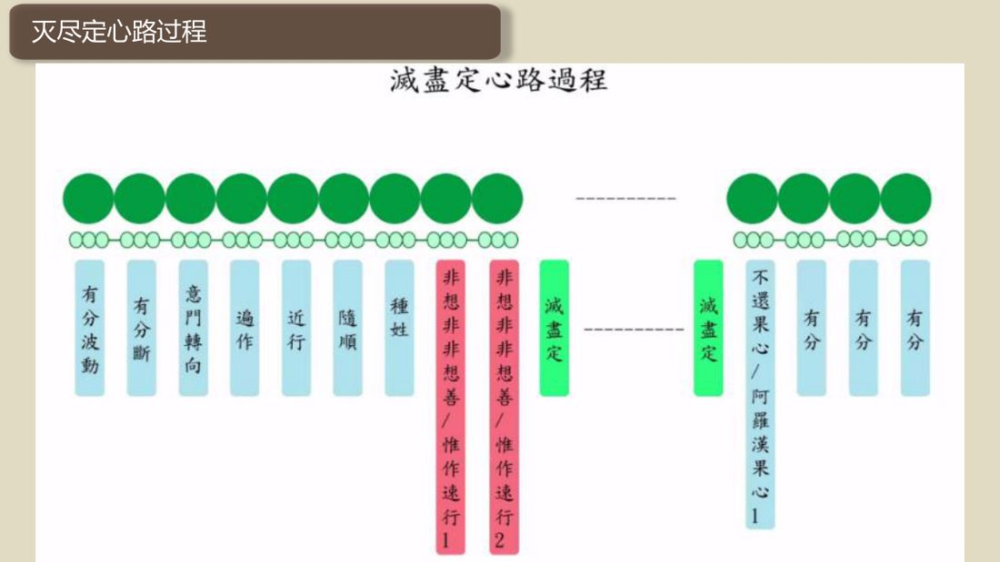
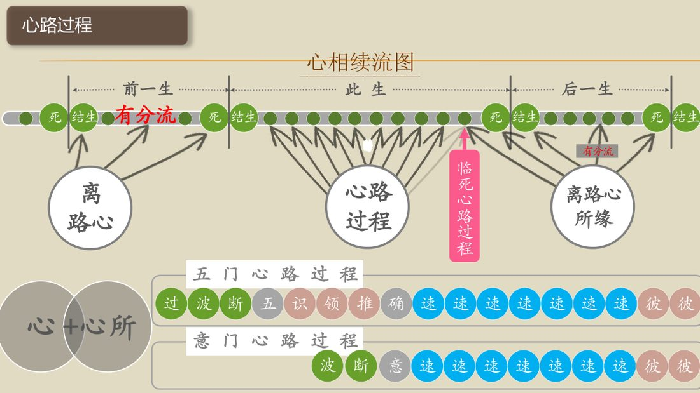

<div align="right">📅 最近更新：2026-10-14 19:51　|　第5版精修（朗读优化版）</div>

# 第4周：速行安止心路与修行应用（主持人版）

**读书会15：心路过程与心识作用 · 第4周（4周版·连续两周合并）**

本周主题：**速行、安止与殊胜心路，及心路的修行应用**。

> ⭐ **本讲主持人速览**（新主持人必读，2分钟看完）
>
> 你不是老师，是"共学同行者"。你不需要提前懂内容，只需要按流程走。
>
> **本周由连续两周内容合并**而成，含两段共读、两轮分享与两轮讨论，单讲 120 分钟。
>
> | 环节         |  标准时长  | ⏱ 时间不够→          | ⏱ 时间富余→   |
> | :--------- | :----: | :--------------- | :-------- |
> | 🧘 静心开场    | 10 min | 缩至5 min          | 加2分钟静坐    |
> | 📖 共读原文1   | 20 min | 只读★核心段（约15 min）  | 加读◈扩展段    |
> | 💬 第一轮分享   | 10 min | 每人1句话            | 每人3分钟     |
> | 🎯 第一轮主题讨论 | 10 min | 只讨论问题①           | 讨论全部问题+扩展 |
> | 🧘 禅修练习    | 15 min | 缩至8 min（只念引导词前半） | 延长至20 min |
> | 📖 共读原文2   | 20 min | 只读★核心段           | 加读◈扩展段    |
> | 💬 第二轮分享   | 10 min | 每人1句话            | 每人3分钟     |
> | 🎯 第二轮主题讨论 | 10 min | 只讨论问题①           | 讨论全部问题+扩展 |
> | 🔚 收尾与回向   | 15 min | 缩至10 min         | 保持        |
>
> **主持人10条守则（精简版）**：
>
> ① 不讲解、不提供答案——让原文自己说话；② 有人问"正确答案"→说"先听听大家的看法"；③ 冷场→主持人先分享自己的真实感受；④ 跑题→温和拉回："这个有意思，我们回到今天的原文"；⑤ 争论→"两种看法都很好，大家保留自己的理解"；⑥ 确保人人发言；⑦ 不评判任何人的分享；⑧ 时间到了就推进；⑨ 禅修练习照读引导词即可；⑩ 结束一起回向。

## 📋 本周信息卡

| 项目   | 内容                                                                                                                                                                                                                                                                                                                                                                        |
| :--- | :------------------------------------------------------------------------------------------------------------------------------------------------------------------------------------------------------------------------------------------------------------------------------------------------------------------------------------------------------------------------ |
| 时长   | 120分钟（4周版 · 9环节）                                                                                                                                                                                                                                                                                                                                                          |
| 核心问题 | 心路里哪一拍才是真正「造业」的？速行×7「前弱后强」意味着什么？道心路、果心路、神通心路、灭尽定心路又是怎样的殊胜心路？我们如何在反应已生起之后介入、重塑自己的速行习惯？；四周学的心路过程，怎么真正落到修行里？「守护根门」到底守什么？「如理作意」在心路的哪一拍起作用？「知道却做不到」的深层原因是什么、我们又该怎么办？日常可以怎样练习观察心路？                                                                                                                                                                                              |
| 共读原文 | 共读原文1：材料①《如来禅修学体系83-摄路分别2》　｜　共读原文2：材料①《如来禅修学体系39-摄心分别1（课件）》、材料②《如来禅修学体系45-摄杂分别1（课件）》、材料③《第012讲-前行-五种规律_大脑与心的关系（共修版）》                                                                                                                                                                                                                                                      |
| 本周作业 | ①简答题：心路里哪几拍是「果报／唯作、不造业」？哪一拍才是「造业」的？为什么说一串速行「前弱后强」，末段速行对业力的去向尤其关键？②实践题：今天挑一次「反应已经生起」的经验（例如已经被惹恼、已经说出一句话），练习在它**已经生起之后**「知道它、松一松、回来」——记录你「回来」的那一刻，只记「回来了」，不评判「为什么没早看见」。；①简答题：写出「五种自然律」的名称；并说明「心的定律」讲了哪几条（一个心识刹那只有一个心生起、刹那刹那生灭、无间相续、所缘清晰度决定心路长短）。②实践题：本周挑一个「入出息念」或「日常一境」的片刻（如坐下观呼吸五分钟），练习「守护根门＋如理作意」——当念头或声音撞进来时，**先对它作意**（不迎不拒），再轻轻回到呼吸；记下你「回来」的时刻，**只记「回来了」，不评判「为什么又跑了」**。 |

## 🗺 本周知识地图：速行、安止与殊胜心路·心路的修行应用（4W4 ＝ 8W7 ＋ 8W8）

```
心路过程与心识作用 · 第4周（8W7＋8W8）
│
├─ 一、造业在速行×7
│   ├─ 速行在「能知」之外多一个「能带出业力」的功能
│   ├─ 五识·果报心·唯作心·彼所缘心都不会带来业力
│   └─ 一串速行「前弱后强」，末段速行对业力去向尤其关键
│
├─ 二、造业「没有一个主宰」
│   ├─ 是自然法则（心的定则·等无间缘）——不必背「我执」的罪
│   └─ 也意味着可以被训练、被重塑
│
├─ 三、殊胜心路（都从意门出、由速行执行）
│   ├─ 道心路（过波断意近随种道果果）· 果心路／果定 · 神通心路 · 灭尽定心路
│   ├─ 道心 20 个（预流·一来·不还·阿罗汉各 5，各具五禅支之一）／果心 20 个
│   └─ 禅那速行无数个；欲界速行最多七个、临终速行五个
│
├─ 四、世间五种定律
│   └─ 时节·种子·业·心·法；心的定律＝一个心识刹那只一心生起·刹那生灭·无间相续·所缘清晰度定心路长短
│
└─ 五、修行两把钥匙
    ├─ 守护根门（弥兰达王）：看得清楚而不被牵走
    ├─ 如理作意：在「确定」与「速行」之间换一副看待所缘的眼光
    └─ 日常练习：入出息念（只记「回来了」次数）＋ 日常一境（知道→知道反应→选择不跟）
```

**本周要点**

1. 造业在速行×7；五识、果报心、唯作心、彼所缘心都不带来业力。
2. 一串速行「前弱后强」、末段尤关键；造业「没有一个主宰」，是自然法则——故可被训练、被重塑。
3. 速行「进入生产车间开始生产」，产品照单全收、不能退；修行是让这一串速行越来越善。
4. 殊胜心路（道心路·果心路·神通心路·灭尽定心路）都从意门出、由速行执行；道心 20 个／果心 20 个。
5. 修行可在反应已生起之后介入、重塑速行习惯——不是「永不失手」，而是越来越早看见、越来越快回来。
6. 世间五种自然律：时节·种子·业·心·法；心的定律讲：一个心识刹那只一心生起·刹那生灭·无间相续·所缘清晰度定心路长短。
7. 修行两把钥匙：守护根门（知道门开了、不轻易放行）＋如理作意（放行时换一副眼光）。
8. 日常练习：入出息念（只记「回来了」）＋日常一境（知道所缘→知道心里的反应→选择不跟着走）。

📌 来源：`知识框架与要点/读书会15_心路过程与心识作用_知识框架与要点.md → 「三、4周版 · 4W4」`

## 🧘 静心开场（10 min）

> 💬 **破冰｜3–5分钟**：今天是否有过「话已经出口、脾气已经上来」才回过神的一刻？说出那个场景，说完就放。

> 🛡️ **心理安全三约定**（每次开场在心里过一遍）：① **保密**——这里说的话不出这间屋子；② **不评判**——不评价任何人的分享，也不急着评价自己；③ **可随时暂停**——任何时候觉得不舒服，都可以停下来休息、喝水或离开，不需要解释。

**（主持人引导语，语速放缓，每句之间留白）**

> 各位法友，请找一个让自己舒适的坐姿，可以盘腿，也可以坐在椅子上。轻轻闭上眼睛，或者让视线柔柔地落在前方地面。先做三次深长的呼吸——吸气，慢慢地；呼气，也慢慢地。
>
> 现在，把注意力带到身体。感觉一下此刻的坐姿，感觉身体与坐垫接触的地方，感觉双手放着的温度。不需要改变什么，只是知道。
>
> 接着，把注意力放到呼吸上。知道吸气，知道呼气。不去控制呼吸，只是陪伴它。吸气进来，呼气出去……如果心跑开了，不要责备它，轻轻地把它带回来，再回到呼吸。心跑开，是它的习惯；把它带回来，是我们的练习。
>
> 今天我们要谈「速行心与业力」。请先给自己一个承诺：接下来的两个小时，我们只是来认识心、观察心，不是来给自己定罪，更不是来算命。速行，就是心真正「动」起来的那一拍；**看见它，就已经很好了**。请记住一句话：**速行虽然快，但修行可以在反应已经生起之后介入——你永远都有「回来」的机会。**
>
> 现在，我们来练习一会儿慈心。先想到自己，在心里轻轻地对自己说：愿我健康，愿我快乐，愿我平安，愿我远离痛苦。
>
> 把这份善意，送给坐在你左右的每一位法友——愿他们健康，愿他们快乐，愿他们平安。
>
> 再把它扩大一些，送给今天要学的法——愿我们听得明白，愿法义入心，愿所学能真正用在生活里。
>
> 好，保持这份开放与柔和，我们慢慢睁开眼睛，回到当下。带着这份不评判、不着急的心，我们一起进入今天的共读。

**（主持人操作）** 开场控制在 10 分钟内。若学员入场慢，可先让早到者安静就坐，准点再开始。本周特别要在开场就埋下两颗种子：一是「**造业在速行、速行可被重塑**」，二是「**修行可以在反应已开始后介入，不必害怕错过**」，后面学员才不会把这一周变成自我审判或宿命论。语气始终作邀请。

## 📖 共读原文1（20 min）

> ⚠️ **主持人操作**：本周共读三份材料（＋一份延伸）。**材料①只读「道心路／果心路／神通／灭尽定／安止速行」相关表格与流程**（道心·果心四个表、神通速行心路三段、灭尽定心路串、「欲界速行后之安止速行」表、所缘强度），这些多为**表格与流程串**，可**投屏/板书**对照读，不逐格念完；**材料②是「速行造业」的内容主体**（速行心与业力九段），建议**重点照读**「能知之外能带出业力」「没有主宰」「生产车间」「越来越强」四处；**材料③读「道心·果心与有因果报心同构、色无色界禅那心与唯作心、有行心」**；材料④作延伸，选读「速行定义」「彼所缘定律」。共读时只念不解释；名相点到即止。以下照录均为逐字原文，供法友轮流照读。

> 朗读节奏建议：材料①的道心路串「过波断意近随种道 果 果」可先慢念一遍、再对照道心20个／果心20个的表；材料②的转写保留时间码，读错的同音字（如「塑形」＝速行、「树形」＝速行、「伪作」＝唯作）不必当众纠正，事后轻声提示即可；材料③的同音字（「树形／火星」＝速行、「无作」＝唯作）同理。

> 读前一句白话（供主持人开场带一句）：「这周我们读的表看着多，其实只有一句要抓——**真正造业的是速行×7；道、果、神通、灭尽定，都从意门出、由速行执行。**」

### 原文材料①：★核心·如来禅修学体系83-摄路分别2-古源尊者-20250330（课件）

- **文件**：《如来禅修学体系83-摄路分别2-古源尊者-20250330（课件）》

**照录（逐字·道心路过程／果定心路过程）：**

> # 出世间禅那心路：道心路过程与果定心路过程
>
> ## 一、道心路过程（Maggavīthi，初次证悟圣道圣果）
>
> 出世间道心路过程，是一般意门心路过程的形式。在"有分断"之后，生起一个意门转向心，随后生起观智速行。这里观智心（从遍作到种姓）生起两次或三次，以有为法的无常、苦、无我三相之一为所缘，其后生起取涅槃为所缘的道心和果心。
>
> 根据慧根的利钝，道心路过程分为两种：
>
> **大慧者（利根，mahāpaññā）的道心路过程：**
>
> > 有分波动 → 有分断 → 意门转向 → 近行 → 随顺 → 种姓 → 道心 → 果心 → 果心 → 果心 → 有分。
>
> 大慧者没有遍作心生起，随顺心只生起两次，接着是种姓、道心，其后生起**三个果心**。
>
> **中慧者（中根，majjhimapaññā）的道心路过程：**
>
> > 有分波动 → 有分断 → 意门转向 → 遍作 → 近行 → 随顺 → 种姓 → 道心 → 果心 → 果心 → 有分。
>
> 中慧者具足遍作、近行、随顺三个前分心，随顺心共生起三次，其后生起**两个果心**。
>
> ---
>
> **逐心说明：**
>
> - **意门转向（M）**：属唯作心，把心转向呈现于意门的目标。
> - **遍作（Pr，Parikamma）**：预备作业，进入安止前分的第一个心。只有中慧者（钝慧者）才有遍作；大慧者（利根者）没有遍作。
> - **近行（Up，Upacāra）**：安止前分的第二个心，心识接近于无常、苦、无我三相之一。
> - **随顺（An，Anuloma）**：安止前分的第三个心，使心识适应于目标，随顺着其后的道智、果智的作用。
> - **种姓（Go，Gotrabhū）**：安止前分的第四个心，抑制五盖。种姓心取涅槃为目标，改变凡夫的种姓成为圣者的种姓。若体证二、三、四果，则以明净心（vodāna）取代种姓心。
> - **道心（Mg，Magga）**：属出世间安止定，只有一心识刹那。道心唯一的作是断随眠（烦恼）。
> - **果心（Ph，Phala）**：属出世间安止定，所缘是涅槃，当下体验涅槃之乐。初次证果者，果心是出世间的果报心。
>
> **说明：** 无论是大慧者还是中慧者，道心路过程里速行都是七个（意门转向之后），大慧者无遍作，其前分心为"近行—随顺—种姓"，速行为"道心—三个果心"；中慧者具遍作，其前分心为"遍作—近行—随顺—种姓"，速行为"道心—两个果心"。这是初次证悟涅槃的心路。
>
> ## 二、果定心路过程（Phalasamāpattivīthi，出世间禅那果定）
>
> 圣者证得道果以后，可以随时再次入果定。此时的心路是意门心路过程，其速行不再有道心，而是直接生起果心：
>
> **大慧者（利根）的果定心路过程：**
>
> > 有分波动 → 有分断 → 意门转向 → 随顺 → 随顺 → 随顺 → 果心 → 果心 → 果心（多次）→ 有分。
>
> **中慧者（中根）的果定心路过程：**
>
> > 有分波动 → 有分断 → 意门转向 → 遍作 → 随顺 → 随顺 → 随顺 → 随顺 → 果心 → 果心（多次）→ 有分。
>
> ---
>
> **逐心说明：**
>
> - 果定心路与道心路过程一样，前分心是随顺心；只是种姓心灭去后，生起的不再是道心，而是圣果心。
> - 圣者入果定时，果心可生起无数次，持续地体验涅槃；果心不能断烦恼，只是体验断烦恼之后的解脱。
> - 果定也有五种性质，与证得的禅那层级相应：若观察初禅名法而道心出起，则果定为初禅（有寻、伺、喜、乐、一境性）；观察二禅、三禅、四禅、五禅名法而道心出起，果定即为二、三、四、五禅的性质，只是所缘由禅那所缘被涅槃所取代。
> - 若阿罗汉再次证入涅槃之果定，其前的善速行为唯作心。


### 出世间心四十种

### 一、什么是出世间心

世间心（欲界心、色界心、无色界心）是生起于三界的心；出世间心则是以涅槃为目标的心，是圣者的心。出世间心是由观照名法、色法或缘起的无常、苦、无我而证入，或一再地进入。体证涅槃、得道果之际，必然以涅槃为目标。

出世间心分为两个阶段：**道心**与**果心**。因为有四道、四果——须陀洹道、斯陀含道、阿那含道、阿拉汉道，对应有四个果——所以总共有**八种出世间心**。

### 二、为什么有四十个出世间心

八出世间心是四种道心（须陀洹道心、斯陀含道心、阿那含道心、阿罗汉道心）与四种果心（须陀洹果心、斯陀含果心、阿那含果心、阿罗汉果心）。若依五色界禅的分类，每一种道心、果心都可能在初禅、二禅、三禅、四禅、五禅中证得，于是五乘以八，就扩展为**四十种出世间心**。

具体来说：

- **道心二十种**：须陀洹道心、斯陀含道心、阿那含道心、阿罗汉道心，各依初禅至第五禅分作五种，共二十种道心。
- **果心二十种**：须陀洹果心、斯陀含果心、阿那含果心、阿罗汉果心，同样各依初禅至第五禅分作五种，共二十种果心。

二十道心加上二十果心，合计**四十种出世间心**。

### 三、四十种出世间心（逐层展开）

**初禅出世间心（八种）：** 初禅须陀洹道心、初禅斯陀含道心、初禅阿那含道心、初禅阿罗汉道心；初禅须陀洹果心、初禅斯陀含果心、初禅阿那含果心、初禅阿罗汉果心。

**二禅出世间心（八种）：** 二禅须陀洹道心、二禅斯陀含道心、二禅阿那含道心、二禅阿罗汉道心；二禅须陀洹果心、二禅斯陀含果心、二禅阿那含果心、二禅阿罗汉果心。

**三禅出世间心（八种）：** 三禅须陀洹道心、三禅斯陀含道心、三禅阿那含道心、三禅阿罗汉道心；三禅须陀洹果心、三禅斯陀含果心、三禅阿那含果心、三禅阿罗汉果心。

**四禅出世间心（八种）：** 四禅须陀洹道心、四禅斯陀含道心、四禅阿那含道心、四禅阿罗汉道心；四禅须陀洹果心、四禅斯陀含果心、四禅阿那含果心、四禅阿罗汉果心。

**五禅出世间心（八种）：** 五禅须陀洹道心、五禅斯陀含道心、五禅阿那含道心、五禅阿罗汉道心；五禅须陀洹果心、五禅斯陀含果心、五禅阿那含果心、五禅阿罗汉果心。

### 四、四十种心的禅支组成

依禅支相应，《摄阿毗达摩义论》这样展开：

- 寻、伺、喜、乐、一境性俱**初禅**须陀洹道心；
- 伺、喜、乐、一境性俱**第二禅**须陀洹道心；
- 喜、乐、一境性俱**第三禅**须陀洹道心；
- 乐、一境性俱**第四禅**须陀洹道心；
- 舍、一境性俱**第五禅**须陀洹道心。

这五种名为须陀洹道心。斯陀含道心、阿那含道心、阿罗汉道心，同样各有五种，正二十道心。如是果心亦有二十种，则出世间心共有四十。

### 五、为何以五禅展开

色界有五禅的差别，出世间心也同样有五禅。其中，无色界的舍与一境性与色界第五禅是一样的；也就是说，四种出世间道心、四种出世间果心与色界第五禅心相同。因此，四十种出世间道、果心，就只剩下三十二种（因无色界的四道四果与色界第五禅的八种相同，故不另计），加上原来的八十九心，构成一百二十一心。

### 六、道心与果心的作用

**道心**是断除或减弱烦恼的那个善心。这个善心生起来，它的作用就是断除和减弱烦恼——这与世间善心（只造善业、积功累德）和不善心（造恶业、给自己制造苦）都不同。道心断除或削弱烦恼。

**果心**是道心这个善心的果报。果报来得最快的就是这个果心——道心生起，下一个心识刹那，无间生起的就是果心。果心是体验由于道心斩除烦恼或削弱烦恼所带来的心的解脱体验、那种感受。果心属于果报心。

道心断烦恼：初果断三结，二果断粗的欲界贪、瞋，三果断微细的欲界贪、瞋，四果断五上分结。

### 七、纯观行者与四十种心的关系

一般的纯观行者，没有安止的禅那，他观察名色法的无常、苦、无我，然后证得初果或二果或三果或四果。他的道心就是：与初禅心（悦俱智相应的心）一样，加上三个离心所——正语、正业、正命。有禅那的人，若已证得四禅八定，但观察一般的名色法、初禅以下的名法而道心出起，他的果定也只能是初禅这种类型的果定。

如果你观察二禅的名法而道心出起，那你的道心就是二禅道心，果心也是二禅果心；观察三禅、四禅、五禅的名法而道心出起，道心与果心就是相应的三禅、四禅、五禅道心与果心。

证果之后，以后再入果定，一般都入它最高的果位的果定。


### 果心二十种

### 总述

出世间心分为道心与果心两类。果心共有二十种，是四道果报所产生的四种果心，每一种果心又依初禅至五禅分作五种，故四乘五得**二十种果心**。

### 二十种果心（逐层展开）

**第一种，预流果心，五种。** 预流果心依禅支的差别，有初禅、二禅、三禅、四禅、五禅五种：

- 寻、伺、喜、乐、一境性俱**初禅**预流果心；
- 伺、喜、乐、一境性俱**第二禅**预流果心；
- 喜、乐、一境性俱**第三禅**预流果心；
- 乐、一境性俱**第四禅**预流果心；
- 舍、一境性俱**第五禅**预流果心。

**第二种，一来果心，五种。** 同样依初禅至第五禅的差别，有五种一来果心。

**第三种，不还果心，五种。** 同样依初禅至第五禅的差别，有五种不还果心。

**第四种，阿罗汉果心，五种。** 同样依初禅至第五禅的差别，有五种阿罗汉果心。

**总计：** 预流果心五种、一来果心五种、不还果心五种、阿罗汉果心五种，合计**二十种果心**。

### 果心的性质

果心是道心断除或减弱烦恼之后，无间生起的果报心。道心是善心，果心则是体验涅槃解脱的果报心。四种果心由四道各自感生：须陀洹道心生起须陀洹果心，斯陀含道心生起斯陀含果心，阿那含道心生起阿那含果心，阿罗汉道心生起阿罗汉果心。

果心不能断除烦恼，它只是体验由道心断烦恼之后的解脱状态。圣者入果定时，果心可以持续不断地生起，多次体验涅槃之乐。


**照录（逐字·神通速行心路）：**

> # 神通速行心路
>
> ## 概述
>
> 神通心路（abhiññājavana-vīthi）是神通生起时的心路过程。要修得神通，在论教里都是以第五禅为依止——以第五禅安止定为神通的基础禅。入神通的过程分为三个阶段：首先入第五禅安止定，然后出定作意生起神通之想，最后进入第五禅神通。
>
> ## 【一】入第五禅安止定
>
> 第一个阶段，是进入第五禅的安止定。其心路过程为：
>
> > **有分心 → 有分波动 → 有分断 → 意门转向 → 遍作 → 近行 → 随顺 → 种姓 → 安止定 → 安止定 → …… → 有分心。**
>
> 逐心说明：
>
> - **有分心**：入定前的生命相续流。能入定或证果者必然是三因者，即有分心为十三个果报心之一（欲界四个智相应善果报心、色界五个果报心、无色界四个果报心）。
> - **意门转向**：属唯作心，把心转向呈现于意门的目标。
> - **遍作**：预备作业，为进入安止作准备。钝根者有遍作，利根者没有遍作。
> - **近行**：接近禅那心，心识接近安止。
> - **随顺**：随顺之前的心，也随顺之后的安止，使心识适应于目标。
> - **种姓**：切断欲界的种姓，转变为色界或无色界的广大种姓。
> - **安止定**（第五禅）：进入第五禅安止速行。初次入禅那或第五禅的神通速行心，只安止速行一次即掉入有分；成熟后则可持续长时间。
>
> 第五禅的名法组成：意门转向十二个名法，遍作、近行、随顺、种姓各三十三个名法，第五禅安止速行三十一个名法（除去寻、伺、喜、乐，加舍）。
>
> ## 【二】出定，作意生起神通之想
>
> 第二个阶段，从第五禅安止定出定后，决意要生起的神通。其心路过程为：
>
> > **有分心 → 有分波动 → 有分断 → 意门转向 → 速行心 ×7 → 有分心。**
>
> 即生起一个欲界速行心路——七个速行心。古源尊者讲：出定以后决意，比如"我要他心通、我要天眼通"，一念就可以了，这是正常的欲界七个速行心的形式。
>
> 这七个速行心，其作意对象依据所要成就的神通不同而有别：《清净道论》说，以十四种御心法调伏其心后，神变智作意"我当成为百、我当成为千"等神变事；天耳智作意粗细差别的音声；他心智作意他人心所依处的颜色及贪等差别心；宿命智作意过去生中死心等差别及前世所蕴集；天眼智作意光明遍满处所的诸色。
>
> ## 【三】进入第五禅神通
>
> 第三个阶段，决意（作意）之后，进入第五禅的神通心。其心路过程为：
>
> > **有分心 → 有分波动 → 有分断 → 意门转向 → 遍作 → 近行 → 随顺 → 种姓 → 神通 → 有分心。**
>
> 古源尊者讲解：如果你的神通熟练，决意以后就会进入第五禅的神通心。它的速行是这样：意门转向、遍作、近行、随顺、种姓之后，生起一个神通心。神通心也只是生起一个刹那——所以你不要看这个人出现神通，可以化现一千个人帮他一起干活，他也是只生起一个神通心；然后剩下他该干嘛干嘛，那一千个人就按照他的意愿干多久就干多久。
>
> 神通心路的名法组成与第五禅一致：意门转向十二个名法，遍作、近行、随顺、种姓各三十三个名法，神通速行三十一个名法（除去寻、伺、喜、乐，加舍）。

**照录（逐字·灭尽定心路过程）：**

> 阿那含或阿罗汉圣者，先入色界定或无色界定，然后出定，观照诸行的无常、苦、无我；再入无所有处定，出定后决意入定期间的预备工作。预备工作包括：令定中资具无损害，僧团有事时出定，佛陀召见时出定，寿尽之前出定。
>
> 预备工作决意完毕，便生起意门转向心，随后是预备、近行、随顺、种姓，接着生起两个非想非非想处的安止速行，然后进入灭尽定——这时所有的心识都消失了，没有心生起，连有分也没有，称为无心定。
>
> 如果决意七天出定，到时候就会自动出定，先生起一次阿那含果心或阿罗汉果心，然后落入有分；落入有分之后，生起一个省察智，省察刚才经历的灭尽定和果心的状态
>
> 

**照录（逐字·心路过程 ——**安止速行表（可朗读版）

### 总述

在进入安止定之前，会先生起几个欲界速行心——即遍作、近行、随顺、种姓（或称"近行定速行"）。在它们之后，便生起安止速行。依照修行者的身份（凡夫、下分果圣者、无学者）以及速行的性质（善心或唯作心、悦俱或舍俱），所生起的安止速行种类数量各有不同。此表总结这一规律：

### 一、三因凡夫与下分果圣者（善心速行）

**智相应善心（四种速行各含4个）：** 三因凡夫与下分果圣者，以大善智相应速行心（4个）作为遍作、近行、随顺、种姓，其后生起的安止速行为：**广大善速行9种、道速行20种、下分果速行15种，总计44种**。

其中，**悦俱智相应善心**（遍作、近行、随顺、种姓各为2个），其后生起**广大善悦俱速行4种、道悦俱速行16种、下分果悦俱速行12种，总计32种**。

**舍俱智相应善心**（遍作、近行、随顺、种姓各为2个），其后生起**广大善舍俱速行5种、道舍俱速行4种、下分果舍俱速行3种，总计12种**。

### 二、无学者（唯作心速行）

**智相应唯作心（四种速行各含4个）：** 无学者以大唯作智相应速行心（4个）作为遍作、近行、随顺、种姓，其后生起的安止速行为：**广大唯作速行9种、阿罗汉果速行5种，总计14种**。

其中，**悦俱智相应唯作心**（遍作、近行、随顺、种姓各为2个），其后生起**广大唯作悦俱速行4种、阿罗汉果悦俱速行4种，总计8种**。

**舍俱智相应唯作心**（遍作、近行、随顺、种姓各为2个），其后生起**广大唯作舍俱速行5种、阿罗汉果舍俱速行1种，总计6种**。


**照录（逐字·心路过程 ——（广大善、惟作心／果／道 总计））：**

- 圣者能生起的广大善/唯作心与道、果速行

### 总述

圣者证得道果之后，能作为安止速行生起的心，依其圣者阶位而不同。此表依"广大善心/广大唯作心 + 果速行 + 道速行"来说明每一位圣者所能证得与生起的安止速行，也就是该圣者入果定或修习时所可能生起的种类数量。

**分述各阶位圣者：**

**第一，三因凡夫。** 三因凡夫能生起的安止速行为：**广大善速行心九种、预流道速行五种，总计十四种**。

**第二，预流果者。** 预流果圣者（初果）能生起的安止速行为：**广大善速行心九种、预流果速行五种、一来道速行五种，总计十九种**。

**第三，一来果者。** 一来果圣者（二果）能生起的安止速行为：**广大善速行心九种、一来果速行五种、不还道速行五种，总计十九种**。

**第四，不还果者。** 不还果圣者（三果）能生起的安止速行为：**广大善速行心九种、不还果速行五种、阿罗汉道速行五种，总计十九种**。

**第五，阿罗汉果者。** 阿罗汉圣者（四果）能生起的安止速行为：**广大唯作速行心九种、阿罗汉果速行五种，总计十四种**。

## 💬 第一轮分享（10 min）

**分享规则**：自愿分享，每人 90 秒～2 分钟；先邀请、不点名；主持人控时，用「90 秒」提示牌。分享只讲自己的体会，不评判他人，不做名相测验。

**起手问题（任选 1–2 个，由浅入深）**：

1. **现场体会**：刚才静心的几分钟里，你有没有察觉「心里某个反应已经动起来了」——比如一丝不耐烦、一点着急、一句想说的话？材料说那「动」的一拍就是速行。**你当时有没有在它已经动起来之后，把注意力带回来过？**
2. **切身比喻**：材料②把速行比作「进入生产车间开始生产」，产品「照单全收、不能退」。用你自己的一个日常例子说说——你有没有「已经生产出来、只能照单全收」的一次反应？你事后是怎么面对它的？
3. **认出「后段的力」**：材料说一串速行「前弱后强」。今天有没有某一刻，你事后发现「前面只是微微一动，到后面却越来越强、收不住了」？只描述，不评判。

**主持人提示**：分享环节最容易滑向两处——一是「算命」（谈来世），二是「自我审判」（谈我又造业了）。请把话头拉回「当下这一念」；若有人卡在「我反应太快、根本来不及」，接住并回：**「修行可以在反应已经生起之后介入。能看见、能回来，就是正念在运作；这不是失败，是进步的起点。」** 别让分享变成自我审判或宿命论。
  
**带节奏的三句话**：①「先说说刚才静心里的体会，不必用名相。」②「有没有哪个反应，是它已经动起来了，你才注意到的？」③「说感受，不比进境，也不算来世。」
  
**倾听约定**：别人分享时，其余人只听、不点评、不抢话；不把别人的体会当成论题来辩论。主持人用一句「谢谢你的分享」收尾，不用「但是」。
  
**时间提醒**：25 分钟若人多，改成「每人 90 秒＋一轮自由补充」；主持人手里始终握计时，宁可截断，也不拖到讨论时间。

## 🎯 第一轮主题讨论（10 min）

**讨论总纲**：本周三个引导问题，分别对应「造业点」「速行×7 的前弱后强」「如何保持正念／如何重塑速行习惯」三条线。每题先静默 1 分钟再开口；主持人只引导、不评判、不代答。别急着给答案，让大家先把「速行」在纸上画一遍。

**问题一（造业点）：心路里哪一拍才是真正「造业」的？**

- 提示：请一位法友照着材料②念一遍——「**除了这个能知能源呢，它（善不善的速行心）还加一个功能……能够带出业力**」，而「五识、果报心、唯作心、彼所缘心」都「不会带来业力」。再问：那么前几周学的转向、五识、领受、推度、确定，是「造业」还是「准备」？（答案：它们是准备，真正造业在**速行×7**。）
- 深化：材料②说速行「**快速的、对欲界都是快速的，对所缘造业**」。请问：为什么偏偏是速行造业？（提示：在「能知」之外，善／不善速行多一个「能带出业力」的功能。）
- 再深化：材料②特别交代——造业「**没有一个主宰**」，是「自然法则（心的定则·等无间缘）」。这告诉我们两件什么？（提示：①不是「我」在造业所以不必背「我执的罪」；②既是自然法则，就可以被训练、被重塑。）
- 备用追问：五识只「看／听」，它会造业吗？（提示：不会。它只是果报心，是承受过去的业。）
- 指向实修：所以我们要用功的地方，不在「看见」本身，而在**看见之后那一拍的转向**——**速行在哪里，修行就在哪里。**

**问题二（前弱后强）：速行×7「前弱后强」意味着什么？末段速行为何关键？**

- 提示：材料②说速行造业的力量「**会持续的、越来越强**」；材料④说「一般速行生起六次或七次；意门迟钝与死亡时五次」。串起来看：一串速行**前面弱、后面强**。
- 深化：论教常从**后段（尤其第七）速行**来论这一串业力的**去向与成熟顺序**。这对修行是坏消息还是好消息？（提示：是**好消息**——因为我们不要在第一念就做到，**把后面几念转过来，力量就在后面**。）
- 再深化：材料②把速行比作「**生产车间**」，产品「照单全收、不能退」。那么「**修行即重塑速行习惯**」这句话，具体指什么？（提示：不是不造业，而是**让这条生产线、让这一串速行越来越善**——一次次把后段的速行转成善速行。）
- 备用追问：临终那一串速行，为什么特别被重视？（提示：因为后段速行的力量最强，常被用来论结生／业力的去向；**本周点到为止，不作来世猜想。**）
- 指向实修：落点是一句——**「不怕第一念，练的是后几念。」**

**问题三（正念与重塑）：速行那么快，我们如何保持正念、如何重塑速行习惯？**

- 提示：材料②形容有分心「按雷迪西亚多来讲就是**蠢蠢欲动**」，所缘一撞击，「过波断五（识）……推度、确定……一确定以后，接下来速行就去扮演速行的功能」。这条链几乎自动发生。那么正念还能插得进去吗？
- 深化：答案就在本周的核心句——**修行可以在反应已开始后介入。** 你可以在贪心已经起来时「知道」，在已经说出那句话之后「看见」它。请问：这种「事后觉察」，算不算正念？（提示：算。**能观察到即正念在运作**；「回来的那一刻」，本身就是善速行。）
- 再深化：材料②说善速行的关键是「**如理作意**」，不善速行是「不如理作意」。所谓「重塑速行习惯」，就是把「不如理作意」慢慢练成「如理作意」——**不是压住反应，而是改变「看待所缘」的方式**。
- 备用追问：那我们每天练的，到底是「不失手」，还是别的什么？（提示：练的是**「回来的能力」**——知道—松一松—回来；不是「永不出错」。）
- 落点：**这一周真正要带回家的，是「我开始在反应之后介入、开始重塑自己那一串速行」这个转向。修行就是——从「被速行带着跑」，走向「开始认识速行、引导速行」。**

**讨论收束句（主持人）**：今天我们看清了三件事——**造业在速行×7；一串速行前弱后强、末段尤关键；而修行可以在反应已开始后介入，把后段的速行一次次转成善速行。** 记住这三句，比记住那几张表更有用。

> **分层追问**（可视时间取用，由浅入深）：
>
> - 【现象】心路里哪一拍才是真正「造业」的？你能指出那一步的名字吗？
> - 【影响】「速行刹那前弱后强」，这对你理解「第一次反应」和「越想越气」的关系有何提示？
> - 【应对】这一周，试着在反应刚起时慢半拍，比如先呼吸一次再说，看看会怎样。

## 🧘 禅修练习（15 min）

### 练习一

> ⚠️ **禅修禁忌提示**：若你正处在严重抑郁、焦虑、创伤后应激，或精神类疾病的发作／用药期，或正经历强烈的情绪危机，请先咨询医生或心理师，再决定是否练习；练习中若出现明显不适（如心悸、胸闷、情绪失控），请立即停止，睁开眼睛，把注意力放回呼吸与身体，必要时离场休息。

**本周练习：观「反应」的速行，练「知道—松手—回来」（照读引导词）**

> 请坐好，闭上眼睛，先做三次深呼吸，让身体放松下来。
>
> 这一次，我们不特别关注呼吸，而是练习一件事：**当心动起来的时候，我们能在它「已经动起来之后」知道它。**
>
> 先让自己安静一会儿，什么都不用做。感觉一下此刻心里是平静的、还是有东西在动。
>
> 如果你想起一件让你有点不痛快的事，注意：**一个反应，可能已经自己动起来了**——也许是一丝不舒服，也许是一句想说的话。不用把它推开，也不必跟着它跑。只是轻轻地**看见它**：「哦，它动了。」这一「动」，就是材料里说的速行。
>
> 你可能会发现，自己**来不及**在它动起来之前就拦住它。请记住：**这很正常。修行可以在反应已经生起之后介入。** 你能做的，是在它已经动起来之后，**知道它、松一松、再回来**。能回来，就已经在练习了。
>
> 现在试一次：如果心里有一个反应，先「知道」它；然后，轻轻地，**不对它做任何事**——不抓、不推，只是让它过去；再把注意力带回身体，回到呼吸。**回来的这一刻，就是一串新的、善的速行。**
>
> 如果心跑远了、钻进故事里了，不要责备自己。**发现自己跑远了，那一刻就已经是觉知在运作了。** 轻轻地，把它带回来，再继续练。
>
> 最后三十秒，把注意力放回身体，感觉坐姿、感觉双手。然后慢慢睁开眼睛。
>
> 请给自己一个友善的念头：**「能看见、能回来，已经很好了。」**


**（主持人操作）** 引导语照读即可，语速放慢、留白。若学员表示「反应太快、根本拦不住」，重申心理安全句：**修行可以在反应已开始后介入、不制造「错过即失败」的焦虑**。时间富余时，加 5 分钟慈心散播收摄；时间紧时，只保持「知道一个反应、带回来」这一句，8 分钟即可。

- **收束句**：「不用把反应压掉，也不必追着它跑；今天练习的只是——**知道它、松一松、回来**。」

### 练习二

> ⚠️ **禅修禁忌提示**：若你正处在严重抑郁、焦虑、创伤后应激，或精神类疾病的发作／用药期，或正经历强烈的情绪危机，请先咨询医生或心理师，再决定是否练习；练习中若出现明显不适（如心悸、胸闷、情绪失控），请立即停止，睁开眼睛，把注意力放回呼吸与身体，必要时离场休息。

**本周练习：守护根门·如理作意——在入出息里练「知道—作意—回来」（照读引导词）**

> 请坐好，闭上眼睛，先做三次深呼吸，让身体放松下来。
>
> 这一次，我们练习两件事：**守护根门**，与**如理作意**。
>
> 先把注意力放到呼吸上。知道吸气，知道呼气。以呼吸为所缘，就像把心轻轻安放在水上的一片叶子。
>
> 现在，让所缘自己来。也许是一个声音、一丝痒、一个念头，从某一门撞进来。**请先「知道」它进来了**——就像守门人，先知道「有人来了」。这就是**守护根门**的开始：不是把门关上，是**知道门开了**。
>
> 接着，**不急着推开它，也不急着跟它走**。在心里，轻轻换一副眼光看它：**它是无常的，它会过去；我不必被它带走。** 这就是**如理作意**——换一副看待所缘的眼光。
>
> 然后，把注意力**轻轻带回呼吸**。回来的这一刻，就是一串新的、清明的意门心路。
>
> 你可能会发现，自己常常「跑掉之后」才回得来。请记住：**这很正常，也很好。修行不是永不失手，而是越来越早地看见、越来越快地回来。能事后觉察，也是进步。**
>
> 如果心跑远了、钻进故事里了，不要责备自己。**发现自己跑远了，那一刻就已经是觉知在运作了。** 轻轻地，把它带回来，再继续练。
>
> 最后三十秒，把注意力放回身体，感觉坐姿、感觉双手。然后慢慢睁开眼睛。
>
> 请给自己一个友善的念头：**「能看见、能作意、能回来，已经很好了。」**

**（主持人操作）** 引导语照读即可，语速放慢、留白。若学员表示「反应太快、根本拦不住」，重申心理安全句：**不苛责，肯定事后觉察也是进步**。时间富余时，加 5 分钟慈心散播收摄；时间紧时，只保持「知道一个所缘、作意、带回来」这一句，8 分钟即可。

- **收束句**：「不用把反应压掉，也不必追着它跑；今天练习的只是——**知道它在，换一副眼光，再回来**。」

**（主持人机动补充·原创）** 若学员坐得安稳、气氛沉静，可在收束句之后再加一句收摄引导：「现在，请把刚才练习的这个能力，轻轻收进心里——**你不需要记住一串心路的名字，只需要记住刚才那种『知道、换眼光、再回来』的感觉。**明天醒来，第一个声音撞进来时，试着也这样做一次。」说完停顿十秒，再请大家慢慢睁眼。此句用于把练习经验「存盘」，让禅修不止停在垫上，而是跟着法友走回生活。若当场有学员眼眶泛红、情绪升起，不必急着问原因，只用一句「很好，慢慢呼吸」护住，让其自然平复。

## 📖 共读原文2（20 min）

> ⚠️ **主持人操作**：本周共读三份材料（＋两份延伸阅读）。**材料③是「心的定律」的内容主体**（世间五种定律／心的定律／业的定律），建议**重点照读**〈心的定律〉一节——「一个心识刹那，只有一个心生起」「刹那刹那生灭」「无间相续」「所缘清晰度定心路长短」四处；**材料①只读「心路过程总说页」之〈心之四相〉与〈五种法则〉**（很短，作为「心的定律」的引子）；**材料②读〈心相续流图〉与〈杂项篇·从六个面向分析心〉**两块（图形以代码文字返回，可投屏/板书对照读，不逐格念）；**材料④〈如理作意〉〈弥兰达王守护根门〉为延伸，时间富余时选读**。共读时只念不解释；名相点到即止。以下照录均为逐字原文，供法友轮流照读。

> 朗读节奏建议：材料③的「五种定律」代码块可先念图内文字（时节／种子／业／心／法），再念正文；材料②的两块 graph 代码块由主持人投屏、念节点标签即可。读错的同音字不必当众纠正，事后轻声提示即可。

> 读前一句白话（供主持人开场带一句）：「这周我们读这三份材料，其实只有一句要抓——**心是刹那刹那生灭、无间相续的；所缘一撞进六门，心路必然生起。所以修行不在「挡住所缘」，而在「守护根门、如理作意」。**」

### 原文材料①：★核心·如来禅修学体系39-摄心分别1-古源尊者-20250210（课件）

- **文件**：《如来禅修学体系39-摄心分别1-古源尊者-20250210（课件）》

⚠️ 主持人操作：本课件为幻灯片，可提取文字仅「心路过程」总说一页。「五种法则」以五行列出（原文无展开说明），本讲取此条目以引出「心的定律」（详见材料③）。课件其余页为巴利文慈心散播发愿文及功德回向文，与本章节无关，未照录；结构性图形页无法逐字提取，不臆造。

**照录（逐字·「心路过程」总说页）：**

> ## 心的定律（cittaniyāma）
>
> **定律一，心念相续无间。** 前一个心灭去后，下一个心立即生起，是无间的，称为无间缘或等无间缘。心生则有分之流断，心灭则沉入有分；有分如流水相续不断，诸心如波涛起伏不定。
>
> **定律二，心路过程有定法。** 心的生起是定法，不会紊乱；三十一界的生命皆如此，不会因不同人而有异——五门心路一定是这样的状态，意门心路也一定是这样的状态。
>
> **定律三，所缘决定果报心。** 若五门遇到可喜所缘，生起的果报心就是善的果报心；体验不可爱的所缘，生起的果报心就是不善的果报心。这是心的定法。
>
> **定律四，有分心连接心路。** 在每一个心路之间，由有分心来连接。每个有分心只维持一个心识刹那，之后另一个心就生起。有分心（离路心）单个生起，不包含在任何心路中，只在两个心路之间起连接作用。
>
> **定律五，一时无二心。** 不可以同时听与看——"一时无二心，一刹那顷皆无二心"。听与看所取的目标不一样，是不同门的心路过程。
>
> **定律六，五门识只识别、意门才加工。** 五识（眼耳鼻舌身）只是识别五所缘，如同照相机只取底色，不会加工；而分析、判断、评价、概念化须由意门心路过程来完成。
>
> ##

### 原文材料②：◈·如来禅修学体系45-摄杂分别1-古源尊者-20250220（课件）

- **文件**：《如来禅修学体系45-摄杂分别1-古源尊者-20250220（课件）》

⚠️ 主持人操作：「心相续流图」「从六个面向分析心」为图形页，见下图。

**照录（逐字·心相续流图）：**

（原表为课件图形页，见《原文全集》）

心相续流图纵贯三世，横摄一世，展现心的流转与轮回。一期生命以**结生心**为第一心，承接上一世的**死亡心**；结生心灭去后，有分心相续生灭，维持心流不断。图中有分流与心路过程交替：没有心路时，有分心如河水般持续流转；当所缘撞击根门，便生起五门或意门心路过程（如"过波断、五识领推、确、七速行、两彼所缘"）。心路之间，始终由有分心连接，保证生命相续不断。生命尽头，死亡心生起，灭后无间断地生起新一世的结生心，随业流转，如此周而复始。



**照录（逐字·杂项篇——从六个面向分析心）：**

（原表为课件图形页，见《原文全集》）

《摄阿毗达摩义论》摄杂分别品，将八十九种心从六个相关角度分门别类：

**受、因、作用、门、所缘、依处**。

依"受"，分析心之乐、苦、舍受；依"因"，分贪嗔痴之根与无贪无嗔无痴之根；依"作用"，即结生、有分、转向、看、领受、推度、确定、速行、彼所缘等十四种作用；依"门"，指眼耳鼻舌身意六门；依"所缘"，即色声香味触法六种所缘；依"依处"，即五净色与心所依处六种依处。

通过这六个面向，以八十九心为纵轴、分类法为横轴，尽一切角度剖析能知能缘之心如何与所缘打交道，帮助修行者透彻了解心的运作，进而净化心灵、提升心的素质。

**照录（逐字·四、摄门 dvārasaṅgaho 论文说明）：**

> **在摄门中：所谓门，即眼门、耳门、鼻门、舌门、身门及意门六种。**
>
> **此如，眼即眼门；同样的，耳等即耳门等；但意门是说（「转向」之前的）「有分」**

### 原文材料③：第012讲-前行-五种规律_大脑与心的关系-（共修版）

- **文件**：《第012讲-前行-五种规律_大脑与心的关系-（共修版）》


### 世间五种定律

**一、时节定律**——规范无生命物质的规律，即火界（温度、能量）的作用。冷热风雨、季节更替、昼夜运转，以及现代物理学、化学所研究的分子原子、万有引力等，皆属时节定律。

**二、种子定律**——即"种瓜得瓜、种豆得豆"，规范动植物遗传、成长与再生，如种子遇缘发芽、人类精卵结合发育。现代遗传学、基因科学即属此范畴。

**三、业定律**——"思"是业，造身语意善恶行必感善恶果报，善有善报、恶有恶报；业是自作自受，每个生命都是独立的名色相续流。

**四、心定律**——心的运作规则：一时无二心，心刹那生灭无间；五门、意门心路依定法不乱；体验可爱所缘生善果报，不可爱所缘生不善果报。

**五、法定律**——佛法特有的因果法则：诸佛须经授记、必在人间出现；道心生果心随生、烦恼必断；证初果不超七生轮回。

前两种属物质规律，后三种属生命领域，须依佛教导体证。

### 心路过程在修行中的应用：两把钥匙

修行的下手处，就是"守护根门"与"如理作意"两把钥匙。

从心路过程看，烦恼生起有其固定轨迹：**所缘经六根门接触我们 → 产生触受 → 若不加防护、不如理作意 → 生起贪、忧、诸恶不善法。** 修行的关键，是在"触受之后、贪爱烦恼生起之前"的关口用功——这个关口正是**速行**阶段。

**第一把钥匙：守护根门。** 佛陀教导："当眼看见颜色，不取于相，不取随相；若不防护眼根而住，则贪、忧、诸恶不善法便会流入。"六根皆然。 "不取于相"是不分别所缘美丑男女，"不取随相"是不判断细部特征；否则生起贪或嗔。从心路看，有分、转向、确定诸阶段无所谓防护，**真正防护与否，取决于速行刹那生起的是善心还是不善心**——是否破戒、失念、无智、无忍、懈怠。 以"城市四门"为喻：根门无防护，如同四门洞开，盗贼（烦恼）长驱直入；根门有守护，则整条心路包括速行都有守护。

**第二把钥匙：如理作意。** 守护根门能否落实，关键在能否如理作意。**能防护速行，在于如理作意与不如理作意；而此非当下临时作意，而是过去养成的习惯——有无正见、是否持戒。** 如理作意主要在五门心路的"确定心"或意门心路的"意门转向心"，由胜解心所执行。

**如何结合落实。** 面对可回避的所缘，应尽量减少接触，堵住滋生烦恼的渠道——"不良信息是烦恼的养分，根门守护不好，烦恼便连绵不断"；面对不可避免的所缘，修习"看只是看、听只是听"，以念守护、行处正知、无痴正知应对。 守护根门重在防护意根、守护心，因五门只采集信息，使信息发酵产生烦恼的是意门。在"缘受生爱"处用功——触受俱生无法避免，但缘受生爱非俱生，可在确定心、意门转向心之后下手。 正念防护与如理作意防护不可全然分开。

掌握这两把钥匙，就是从速行关口断除烦恼，趋向涅槃。

## 💬 第二轮分享（10 min）

**分享规则**：自愿分享，每人 90 秒～2 分钟；先邀请、不点名；主持人控时，用「90 秒」提示牌。分享只讲自己的体会，不评判他人，不做名相测验。

**起手问题（任选 1–2 个，由浅入深）**：

1. **四周回顾**：四周里，哪一「周」的名相／画面，最后变成了你生活里真能用上的一句话？（比如「速行」「有分」「如理作意」……）说说它是怎么从「书上」走到「今天」的。
2. **切身体会**：材料③说「在一个心识刹那，只有一个心生起，心是刹那刹那生灭的」。你有没有一个时刻，**真实地感到「心一个接一个地变」，你按不住它**？那时你是怎么面对的？
3. **「知道却做不到」**：这四周你有没有过「道理都懂了，可我还是老样子」的感觉？**那一刻，你是责备自己，还是允许自己慢慢来？** 只分享，不比较。

**主持人提示**：分享环节最容易滑向两处——一是「自我审判」（「四周了还这样，我没用」），二是「名相测验」（互相考定义）。请把话头拉回「当下这一念、这一个人」。若有人卡在「我做不到」，接住并回：**「能事后觉察，也是进步；修行不是永不失手，是越来越早地看见、越来越快地回来。」** 别让分享变成评判。
  
**带节奏的三句话**：①「先说体会，不必用名相。」②「有没有哪一句，是你生活里真用上了的？」③「说感受，不比进境，也不考试。」
  
**倾听约定**：别人分享时，其余人只听、不点评、不抢话；不把别人的体会当成论题来辩论。主持人用一句「谢谢你的分享」收尾，不用「但是」。
  
**时间提醒**：25 分钟若人多，改成「每人 90 秒＋一轮自由补充」；主持人手里始终握计时，宁可截断，也不拖到讨论时间。

## 🎯 第二轮主题讨论（10 min）

**讨论总纲**：本周三个引导问题，分别对应「四周框架回顾＋以入出息念为例分析心路」「『知道却做不到』分析与守护根门·如理作意」「心路观察的日常练习计划」三条线。每题先静默 1 分钟再开口；主持人只引导、不评判、不代答。别急着给答案，让大家先把「心路」在自己的经验里走一遍。

**问题一（四周框架回顾 + 以入出息念为例分析心路）：这四周我们学了什么？修的时候，这一串心路是怎么走的？**

- 提示：请先在黑板上把四周的骨架写出来——**第1周 总说与五门（过波断五识领推确速速速速速速速彼彼）→ 第2周 意门 → 第3周 离路心与十四种心识作用 → 第4周 速行与业力／道果心路、修行应用**。再问：**这四周，哪一周是「地图」，哪一周是「路」？**（提示：前三周是地图，本周是「路」——心真正走起来、造业、修行的那条路。）
- 以「入出息念」为例（讨论重点）：让一位法友描述「坐下观呼吸、心跑掉、再回来」的过程，然后由主持人用论教「复盘」——**呼吸（触所缘）撞进身门→有分波动→有分断→……→领受→推度→确定→速行×7→彼所缘→有分**；或若落在「意门」（安般念以意门为主）——**波→断→意（意门转向）→速速速速速速速→彼彼**（材料②「心相续流图」、材料⑤「欲界纯意门心路过程」）。**问：当你说「心跑掉了」，这一串心路里，你「看见」的是哪一拍？**
- 深化：材料③说「当所缘很明显、很清楚的时候，这个心路一定是这样的……只有一个有分波动一下」。**问：为什么有时你「完全没感觉到念头起来」，它就过去了？**（提示：所缘不够清晰时，心路短到只剩「有分波动一下」——这正是「看不见」的正常原因。）
- 指向实修：落点是一句——**「这一串心路，不是你『想』出来的，是它自己『流』出来的；修行，就是在这条流上，加进『知道』这一拍。」**

**问题二（「知道却做不到」分析 + 守护根门与如理作意）：为什么会「知道却做不到」？我们能做什么？**

- 提示（先把「不苛责」立起来）：**先承认——「知道却做不到」是所有凡夫心的常态，不是你一个人的问题。** 再请法友一起找出原因。
- 第一层（速度差）：材料④说「在弹指之间，超过一兆个心识生起和消失」。「知道」是很慢的一层，「反应动起来」是极快的一层。**问：这说明了什么？**（提示：慢的「知」追不上快的「动」，是物理性的，不是道德问题——所以别苛责自己。）
- 第二层（所缘铺天盖地）：材料③说五门必然生起完整心路，意门亦复如是。**问：环境不配合，是不是常态？**
- 第三层（习气靠重复养）：材料④讲「经由重复练习来约束自己的心，会使不善思维渐渐减少」。**问：反过来，习气是不是也被「重复」喂大的？**（提示：既然是重复喂大的，就靠重复来改，不靠一次性决心。）
- 落到两把钥匙（本问题核心）：
  - **守护根门**（材料④）：弥兰达王训练心七日，立八条，第 7 条——「**当看到、听到和经验到感官目标时，我会遏制我的感官冲动，即眼、耳等等，以避免有害的思维。**」**问：「守护根门」是「不看、不听」，还是「看得清楚而不被牵走」？**（提示：是后者。所缘必然撞进门、心路必然生起——这是心的定律；我们能做的是不让它一路滑到不善的速行。）
  - **如理作意**（材料④＋本周）：《阿毗达摩轻松谈》开篇即讲「**由于正确的态度，不善的心就不会出现，而只有善心会生起**」；本周材料②说善速行的关键是「如理作意」。**问：把「守护根门」和「如理作意」接起来看，它们是什么关系？**（提示：守护根门是「在门口不轻易放行」，如理作意是「放行时换一副眼光」——同一件事的前后两拍。）
- 指向实修：落点是三句——**「不苛责，肯定事后觉察也是进步」；「不是压住反应，而是改变看待所缘的方式」；「修行不是永不失手，是越来越早地看见、越来越快地回来」。**

**问题三（心路观察的日常练习计划）：这一周，我们可以怎样把「观察心路」落到日常？**

- 提示：请法友一起，为「接下来一周」订一份**具体、可执行**的小计划。核心两个动作：
  - **动作一｜入出息念（安般念）**：每天固定一小段（如 5—10 分钟），以呼吸为所缘，体会「**知道呼吸—跑掉—回来**」这一串的重复（论教上即「意门心路」的反复）。**记法**：只记「回来了」的次数，不记「跑掉」的次数据以自责。
  - **动作二｜日常一境（守护根门）**：一天挑 2—3 次「一个明显的所缘」，如「听到一个刺耳的声音」「看到一条让人心动的讯息」。练习三步：**① 知道所缘（耳门／眼门心路生起，正常）；② 知道心里的反应（如理／不如理作意）；③ 选择不跟着走（不让它滑到不善速行）。**
- 深化：材料④「心可被驯服」说——「如果连缓慢变异的身体都可以改善，那么为什么不能驯服那快速改变与容易改善的心呢？」**问：这句话给了你什么力量？**
- 再深化：材料②「从六个面向分析心」给出六把「分析的刀」（**依处／所缘／受／因／作用／门**）。**问：我们日常观察心路，从这六个面向里的哪一个入手最方便？**（提示：多数人从「门」与「受」入手最可感——「从哪一门进来的？当下是什么受？」）
- 落点：**「不求多，求『一天两三次真的看见』。四周学的这张网，从今天开始，一天撒两三次。」**

**讨论收束句（主持人）**：今天我们收了三件事——**四周的地图铺开了，心路就是此刻正在流的那条河；「知道却做不到」是有原因的，不苛责；而练的，就是「守护根门＋如理作意」，一天两三次，把『看见』这一拍，慢慢加进心路里。** 记住这三句，比记住那几张表更有用。

**主持人机动补充（原创，时间富余时加开）**：若三题提前讨论完、尚有富余，可加开一道「收束题」——**「四周之后，我打算把哪一件小事，固定成每天的动作？」** 引导时务必把它做小：不是「我要精进修行」，而是「我每天晚饭后坐五分钟，只听呼吸」「我每天开车等红灯时，把心带回呼吸三次」。请两三位法友各说一件，主持人不点评、只板书关键词，最后收一句：**计划越小越能长久；修行靠的是重复，不靠决心。** 若有人说「我怕又坚持不下来」，接住并回：**「做不到也不用自责，明天再回来就好——这本身就是本周练的那件事。」**

> **分层追问**（可视时间取用，由浅入深）：
>
> - 【现象】「守护根门」和「如理作意」，你分得清它们各自守在、作用在心路的哪一拍吗？
> - 【影响】「知道却做不到」，在你自己的经验里，最常卡在哪一个环节？
> - 【应对】这一周，选一件日常小事（如吃饭、走路），试着观察一遍它背后的心路。

## 🔚 收尾与回向（15 min）

**总结引导（主持人照读）**：

> 各位法友，这一周我们走进了「速行」——心真正「动」起来、造业的那一拍。请把今天的收获收成三句话——
>
> 第一句：**造业在速行×7**——转向、五识、领受、推度、确定都只是「准备」；果报心与唯作心都不造业，只有善／不善的速行「能带出业力」。
>
> 第二句：**一串速行，前弱后强**——越到后段越有力，因此常从后段（尤其第七）速行论业力的去向；**修行就是让后段的速行越来越善。**
>
> 第三句：**殊胜的心路，走的是同一套机制**——道心路、果心路、神通心路、灭尽定心路，都从意门出、由速行执行。
>
> 请带着一个问题回家：**今天我遇到一次反应时，是在「被速行带着跑」，还是「知道它、松一松、回来」过？** 记住那句话——**修行可以在反应已开始后介入；能回来，就已经在重塑你的速行习惯了。**

**答疑预留（5 分钟，可并入收尾）**：若时间允许，留 5 分钟给 1–2 个提问。常见问题可直接用前文「学员常见提问与回应」表应对；遇到答不了的，坦承「这个我记不确，下次查了再说」，不必硬撑。答疑时始终守着两条：**不诊断、不玄谈来世**。

**回向（照读）**：

> **愿我此功德，导向诸漏尽！**
>
> **愿我此功德，为证涅槃缘！**
>
> **我此功德分，回向诸有情！**
>
> **愿彼等一切，同得功德分！**
>
> 萨度！萨度！萨度！

**总结引导（主持人照读）**：

> 各位法友，四周走到今天，我们第一次把这几周学的东西，真正「合起来」用了一次。请把今天的收获收成三句话——
>
> 第一句：**心路过程不是一张表，是你此刻正在发生的事**——所缘撞进六门，心路必然生起，一串一串刹那生灭；这，就是「心的定律」。
>
> 第二句：**修行只有两把钥匙——守护根门与如理作意**——守护根门，是「知道门开了、不轻易放行」；如理作意，是「放行的时候，换一副眼光」。心路可以塑，靠的就是这两把钥匙的重复。
>
> 第三句：**「知道却做不到」不苛责**——「知道」追不上「反应」，是自然的；练的是「越来越早地看见、越来越快地回来」。**能看见，就已经在参与；事后觉察，也是进步。**
>
> 请带着一个问题回家：**这一周，我能不能一天挑两三次，练习「知道所缘—知道反应—换一副眼光—回来」？** 记住这句话——**修行不是在书里，是在你此刻这一串心路里。**

**答疑预留（5 分钟，可并入收尾）**：若时间允许，留 5 分钟给 1–2 个提问。常见问题即兴回应；遇到答不了的，坦承「这个我记不确，下次查了再说」，不必硬撑。答疑时始终守着两条：**不苛责、不玄谈**。

**四周共学圆满（末次小结，照读）**：

> 各位法友，今天是读书会15《心路过程与心识作用》四周共学的圆满。四周以来，我们从「心路过程总说」出发，走过眼门的十七心识刹那、耳鼻舌身与共同模式、意门与意门转向、离路心的生命相续、十四种作用与所缘强弱、速行与业力、安止与道果心路，到今天终于落到实处——**守护根门与如理作意**。感谢每一位法友的相伴与认真：你们把这段「心的地图」，一寸一寸地走成了「自己的路」。
>
> 学法是因缘和合，能一起走完四周，是我们彼此难得的善缘。愿我们把这四周所学的法、所生的善，都回向给一切众生；也愿我们各自回到生活里，把那两把钥匙，用在自己的每一天、每一门、每一念。

## 📌 本讲主持人特别提醒

1. **心理安全（本周重点）**：本周涉「速行造业、业力」，最容易引发两种情绪——**自我审判**（「我又造不善业了、没救了」）与**宿命感**（「业力既定，我改不了」）。请在开场、练习与讨论中反复埋两句：**「修行可以在反应已开始后介入」**、**「不制造『错过即失败』的焦虑」**。同时提醒：**观察速行造业是了解心的自然运作，不是审判自己；能观察到即正念在运作。** 不要诊断、不要给心理学标签；成员情绪波动时，提供呼吸放松或暂离的选项。
2. **不把「业力」讲成算命**：本周材料谈「前弱后强、末段速行」，学员很容易追问「那我下辈子会怎样」。请明确：**本周的重心是「可介入、可重塑」，不是「预测来世」。** 遇此类追问，温和收线、拉回当下。
3. **不玄谈「神通、灭尽定、前生」**：材料①有神通心路、灭尽定心路，点到即止——本周重心是「殊胜心路也走同一套机制」，不要把话题引向神秘体验或进境比较。
4. **名相只点一句白话**：速行、业力、道心/果心、神通/灭尽定、安止速行——用白话卡点明即可，不展开学术，不考试。特别澄清「速行≠速度快」。
5. **照读与解释分开**：共读原文只读不解释；解释留到分享与讨论。表格（道心20个、果心20个、安止速行表）可投屏对照，不逐格念完；宁可少读，也要留出讨论时间。
6. **时间与回向**：严守 120 分钟流程（10／25／20／35／15／15）；无论怎么压缩，静心与回向都不可省，回向务必导向一切众生。
7. **本周的「一句话兜底」**：若全场某处卡住、或时间不够，用这一句把主线拉回来——**「造业在速行；后段速行最强；修行可以在反应已开始后介入。」** 说完全场就能重新聚焦。
8. **本周不做什么**：不诊断、不比较进境、不玄谈神通与来世；**不把「造不善业」讲成道德指责**；不要求学员「当场就拦住反应」——**「回来的能力」是结果，练习是过程。**
9. **主持人自我关怀**：速行与业力是最贴近「自我评价」的题目，带完这一场，你自己也可能被牵动。会后给自己三分钟静一静、回向一下，也是护持场域的一部分。

---

<!--EXT_READ-->
## 📖 延伸阅读（课后自由选读）

- 《136讲-摄路23-心的修行_速行_彼所缘（音声）》——速行心与业力、如理作意与不如理作意。
- 《第012讲-前行-五种规律_大脑与心的关系（共修版）》——五种世间定律，尤以心的定律、业的定律为主体。
- 《阿毗达摩轻松谈》——〈正确的态度【如理作意】〉〈弥兰达王如何训练他的心〉〈心可被驯服〉。
- 《摄阿毗达摩义论表解-简体-完整版201802》——速行定义、彼所缘定律、速行／安止心路表。
<!--/EXT_READ-->
