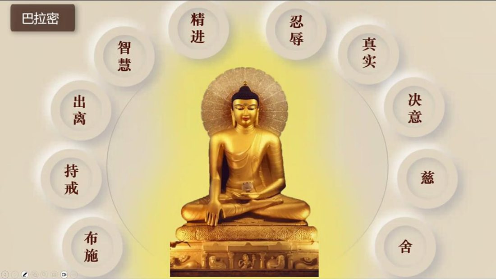

<div align="right">📅 最近更新：2026-10-15 17:21　|　第5版精修（朗读优化版）</div>

# 第2周：菩萨授记与巴拉密次序（主持人版）

> ⭐ **本讲主持人速览**（新主持人必读，2分钟看完）
>
> 你不是老师，是"共学同行者"。你不需要提前懂内容，只需要按流程走。
>   
> **本周由连续两周内容合并**而成，含两段共读、两轮分享与两轮讨论，单讲 120 分钟。
>
> | 环节         |  标准时长  | ⏱ 时间不够→          | ⏱ 时间富余→   |
> | :--------- | :----: | :--------------- | :-------- |
> | 🧘 静心开场    | 10 min | 缩至5 min          | 加2分钟静坐    |
> | 📖 共读原文1   | 20 min | 只读★核心段（约15 min）  | 加读◈扩展段    |
> | 💬 第一轮分享   | 10 min | 每人1句话            | 每人3分钟     |
> | 🎯 第一轮主题讨论 | 10 min | 只讨论问题①           | 讨论全部问题+扩展 |
> | 🧘 禅修练习    | 15 min | 缩至8 min（只念引导词前半） | 延长至20 min |
> | 📖 共读原文2   | 20 min | 只读★核心段           | 加读◈扩展段    |
> | 💬 第二轮分享   | 10 min | 每人1句话            | 每人3分钟     |
> | 🎯 第二轮主题讨论 | 10 min | 只讨论问题①           | 讨论全部问题+扩展 |
> | 🔚 收尾与回向   | 15 min | 缩至10 min         | 保持        |
>
> **主持人10条守则（精简版）**：
>   
> ① 不讲解、不提供答案——让原文自己说话；② 有人问"正确答案"→说"先听听大家的看法"；③ 冷场→主持人先分享自己的真实感受；④ 跑题→温和拉回："这个有意思，我们回到今天的原文"；⑤ 争论→"两种看法都很好，大家保留自己的理解"；⑥ 确保人人发言；⑦ 不评判任何人的分享；⑧ 时间到了就推进；⑨ 禅修练习照读引导词即可；⑩ 结束一起回向。

> 本周主题：**菩萨授记——须弥陀（善慧）于燃灯佛前发至上愿、以身作桥，当众受记；受记后省察十巴拉密并排定其次序**。

## 📋 本周信息卡

| 项目   | 内容                                                                                                                                                                              |
| :--- | :------------------------------------------------------------------------------------------------------------------------------------------------------------------------------ |
| 时长   | 120分钟（4周版 · 9环节）                                                                                                                                                                |
| 核心问题 | ；菩萨受记之后做了什么？「省察巴拉密」省察的是什么？十巴拉密为什么按布施→持戒→出离→智慧→精进→忍辱→真实→决意→慈→舍这个次序排列？                                                                                                            |
| 共读原文 | 共读原文1：材料①《巴利三藏中的菩萨道思想04-菩萨授记-古源尊者-20250624》　｜　共读原文2：材料①《巴利三藏中的菩萨道思想05-省察巴拉密、布施巴拉密1-古源尊者-20250625（音声）》                                                                           |
| 本周作业 | ；①简答题：十巴拉密的先后次序是怎样的？请用自己的话说出「布施先于持戒」「忍辱先于真实」的次序理由各一条。②实践题：本周挑一次自己做过的布施（供养、帮忙、捐物、让座都算），事后安静回想它的「前思、中思、后思」——布施前的起心、布施中的心、布施后的随喜，只记录、不评判。③省察题：从十条巴拉密里选出你自己**最亲近**的一条，写下它对你个人意味着什么。 |


## 🗺 本周知识地图

```
├─ 一、前缘：燃灯佛与不死城的须陀
│   ├─ 时间：四个阿僧祇劫又十万大劫之前 · 不死城（阿玛拉瓦达／阿玛拉瓦蒂）
│   └─ 须陀（善慧·苏梅达）婆罗门 —— 「婆罗门」＝梵天（波拉曼），原指修行投奔梵天者
├─ 二、观身不净，发心求涅槃
│   ├─ 生老病死四苦 → 杜卡（dukkha）＝不圆满、受逼迫、会坏灭、不恒常
│   ├─ 身体九孔漏秽：尿·粪·脓·血·胆汁·痰·唾液
│   └─ 五个譬喻：粪坑见池（池不净，人自净）· 敌人围路不见 · 重病遇医不求
│       · 肩负死尸 · 舟漏 · 身怀巨宝遇强盗
├─ 三、舍财出家与大布施（觐见国王·鸣鼓遍告·平等大施）
│   ├─ 七代祖先连一个钱币都带不走 → 财富非究竟
│   ├─ 觐见国王请纳万金 → 国王不受 → 击鼓遍告
│   └─ 不分贫富贵贱，平等分发 → 然后出家
├─ 四、前往喜马拉雅山·证八定五神通（依《佛种姓经》）
│   ├─ 建禅园与草屋 → 舍屋 → 树下而住（逐层舍弃）
│   ├─ 舍五谷·取树果 · 不躺下·坐立行三姿势
│   ├─ 七天内证得五神通
│   └─ 八定＝四色界禅＋四无色界禅；五神通＝神变·天耳·他心·天眼·宿住随念
├─ 五、燃灯佛出世·须陀错过瑞相
│   ├─ 燃灯佛（巴利名迪班达拉）· 一万个世界震动
│   ├─ 入胎·出生·证悟佛果·初转法轮四阶段瑞相，须陀皆未觉察
│   └─ 原因：沉浸八定，常游森林天空，对人间俗世不感兴趣
├─ 六、★补路遇佛·解发铺地以身作桥·发至上愿（本周核心）
│   ├─ 市民修路 → 须陀主动请缨 → 拒用神通，愿以体能做
│   ├─ 见佛：三十二大人相·八十种随行好·身如纯金·六种声光
│   ├─ 解开发髻，黑豹皮与袈裟覆泥坑，作五体投地如拱桥
│   ├─ 发的不是「我要解脱」，而是——
│   │   「我将致力于成就佛果，再解救一切众生脱离生死轮回的苦海」
│   │   「舍弃三界、度过生死苦海之后，我将踏上八正道的法华，
│   │     再去解救一切众生」
│   ├─ 须弥多献五朵莲花·愿为伴侣 → 佛预言她终成女弟子
│   └─ 授记八法在此齐备；「增上行善」＝即使布满火炭尖矛也不退缩
├─ 七、★燃灯佛授记：四阿僧祇劫又十万大劫后成佛，名乔达摩
│   ├─ 授记九偈要点：迦毗罗卫城出家苦行 → 阿迦巴罗榕树下乳糜供养
│   │   → 尼连禅河 → 菩提树顺时针绕转 → 证彻知四圣谛的观智
│   ├─ 上首弟子：舍利弗（拘利多）· 目犍连（优婆底萨）· 侍者阿难陀
│   ├─ 受记之后：自己顺序与逆序省察十种巴拉蜜
│   └─ 此后二十八尊佛，其中二十三尊再为他授记
└─ 共读原文2·省察十种巴拉密的次第（8W4 专题）
    ├─ 为何布施先？布施助持戒、众生共有、易行
    ├─ 逐对理由：持戒→出离（净戒易得禅定）→智慧（无禅定无智慧）
    │   →精进→忍辱（精进圆满忍辱）→真实（真实方能久忍）
    │   →决意（决意圆满真实）→慈→舍（舍净化慈）；悲心与舍心互相摄持
    ├─ 烦恼三层次：违犯性（戒止）→困扰性（止禅镇伏）→潜伏性（智慧根除）
    │   ＋火柴三火譬喻 ＋三学对治
    └─ 布施＝思心所（cetanā）：前思·中思·后思，三思具足布施才圆满

**本周要点**

1. 授记是菩萨道的**真正起点**——须陀（善慧）看透生老病死之苦，观身不净，遂舍尽家财、鸣鼓遍告、平等大施，出家赴喜马拉雅山，证得**八定五神通**。
2. 燃灯佛走来时，他**解开头发、铺在泥坑上、以身作桥**，让佛陀与僧团踏过；他发下的不是「我要解脱」，而是「**我要成佛，以度一切众生**」——这就是**至上愿**。
3. 燃灯佛当众**授记**：他将在**四个阿僧祇劫又十万大劫**之后成佛，**名为乔达摩**。被授记后才称「真正的菩萨（未来佛）」。
4. **授记八法**＝人身·男性·因·见师·出家·得成就·真善行·极强善欲；其中最难的是「因」——闻一偈即证阿拉汉（慧者第三句、精进者第四句）。
5. 被授记后，须陀**自己省察十种巴拉密**（顺序、逆序、双对反复省察）——**授记不是终点，而是「开始走」**。
6. 此后直到释迦牟尼佛，先后有**二十八尊佛**，其中**二十三尊**都再为他授记。
7. **十种巴拉密的次序不是排名，是接力**：布施「利益他人」喂出持戒「不伤害他人」，逐对相扶；底下是烦恼三层次（违犯性→困扰性→潜伏性）与三学（戒→定→慧）的对治。
8. 全程基调：**舍身故事体会即可，不模仿、不追求**；本周讲的是「一条路怎么开始的」，不是「你够不够格」。

📌 来源：`知识框架与要点/读书会17_菩萨道思想（一）_知识框架与要点.md` → 「三、4周版 · 4W2　菩萨授记与巴拉密次序（＝8W3 + 8W4）」
## 🧘 静心开场（10 min）

> 💬 **破冰｜3–5分钟**：先让呼吸落下来。这周有没有一个瞬间，你为别人多做了一点点、对方却未必知道？一句话说说那个瞬间，说完就放下。

> 🛡️ **心理安全三约定**（每次开场在心里过一遍）：① **保密**——这里说的话不出这间屋子；② **不评判**——不评价任何人的分享，也不急着评价自己；③ **可随时暂停**——任何时候觉得不舒服，都可以停下来休息、喝水或离开，不需要解释。

**主持人引导语**（照读即可）：

> 我们先静坐一分钟。闭上眼睛，感受自己的呼吸，让心慢慢安静下来。（停顿60秒）
> 今天是《菩萨道思想（一）》读书会的第二周。上一周我们认识了"三种菩提、三种菩萨"，也把"十种巴拉密"的框架搭了起来。这一周，我们把镜头拉回到最初——回到四个阿僧祇劫又十万大劫之前，回到一位名叫须弥陀的婆罗门面前。他还不是菩萨，他只是一个看透了生老病死、想找一条出路的人。
> 他后来做了一件事：当他看到燃灯佛走来时，他解开自己的头发，铺在泥坑上，趴下来，让佛陀和四十万阿罗汉从自己的背上走过去。那一刻，他发了一个愿——不是"我要解脱"，而是"我要成佛，好把一切众生从轮回的苦海里救出来"。这，就是菩萨道的起点。
> 今天我们不急着感动，也不急着评判。我们先把这段故事**完整地读一遍**：他为什么出家？他凭什么被授记？被授记之后又发生了什么？然后我们慢慢聊——不是聊"我够不够格"，而是聊"这份无我的利他心，究竟是怎样一种心"。
> 先约定一件事：故事里有"舍身"的情节，我们**尊重它、体会它，但不模仿它、不追求它**；今天只要有一句愿文让你心里动了一下，就不虚此行。

---

## 📖 共读原文1（20 min）

> ⚠️ 主持人操作：以下为完整原文文字，可直接照读或让大家轮流朗读，无需查知识库。出处信息见各材料下方；音声转写段落前的时间码（如[00:01:52]）是出处标记，朗读时跳过不念；（ ）内为整理注记，同样跳过不念。★核心必读；◈扩展时间富余时读。

### 原文材料①：★核心·巴利三藏中的菩萨道思想04-菩萨授记-古源尊者-20250624（依据录音转写整理，已校对明显同音错字）

- **文件**：巴利三藏中的菩萨道思想04-菩萨授记-古源尊者-20250624（音声·★核心）

**【须弥陀菩萨：释迦牟尼佛成为菩萨的本生故事】**
**【一、前缘：燃灯佛与不死城的须弥陀】**
昨天我们学习了成就十种巴拉密的十六种素质。今天，我们来看看我们释迦牟尼佛成为菩萨的这个故事。释迦牟尼菩萨是在燃灯佛的座下受记的。从燃灯佛到我们现在，是过了四个阿僧祇劫又十万个大劫——也就是在四个阿僧祇劫加十万个大劫之前，菩萨出身的。所以那个时候，有一个很繁荣的城市，叫不死城（阿玛拉瓦达、阿玛拉瓦蒂），这是一个在很多方面都很好的城市。它很美丽，人们感到生活很幸福。那么，在这个不死城里面，有一个叫苏梅达、我们过去翻译成须弥陀或者妙智的婆罗门。

这个婆罗门，很多人认为婆罗门可能以前就是印度教，它只是婆罗门被印度教这么称谓而已。这个婆罗门，它就是"不拉嘛"，"布拉曼"，它就是梵天的意思。所以它在梵语里面就"波拉曼"，波拉曼就是婆罗门，这个波拉曼就是梵天。那么梵天是什么意思呢？就是说，他们在日常的时候修行，想投奔到梵天去的那些人，早期就称为波拉曼、婆罗门。后面演变成婆罗门只是祭祀、只是诵经，它都已经异变了。

**【二、观身不净，发心求涅槃】**
所以，这个婆罗门有一天正在他的大房子楼上打坐，他就想：生是很苦的，这个生命最终要毁坏也是很苦的，会受到老的折磨，死的时候稀里糊涂、好像愚痴地死去，也是很苦的。这个苦，我们讲过，这叫杜卡，在梵语或者巴利都是叫杜卡。杜卡，就是不圆满、受逼迫、会坏灭、不恒常的这样一种生存状态，称为杜卡。那么须弥陀认为，这些都是逃不过去的，所以只要有生，就有老病死。

怎么样去寻找能够熄灭老病死以及这种恐惧的涅槃呢？如果我能够毫不执著地舍去这个充满尿、粪、脓、血、胆汁、痰、唾液这些很污秽的身体，那不是很美妙吗？所以一般人来讲，我们都觉得这个身体很重要、很美妙；那么从菩萨的角度来看，就是充满了脓血，这个肚子里都是粪便、都是痰、都是唾液，这没有任何可美妙的。须弥陀就认为：肯定有一个能够去向这个寂静的、不受生命束缚的这样一个道路，不可能没有。我一定要去寻求这个涅槃之道，以便突破生命的束缚。

譬如这个世界有苦也有乐，同样的，一定有导致苦的生死轮回，也一定有导致灭苦的涅槃；有热必定有冷，同样的，有贪嗔痴之火，必定有熄灭这三种火的涅槃；有恶业也有善业，同样的，有生，不一定有子息再生的涅槃（有生就必定有不生的涅槃）。

过后，他深入地思维：譬如有人掉进粪坑，沾满粪的人看到远处有一座五种莲花点缀的清澈的水池。如果他见到这个水池之后，仍然不肯去找出通向它的道路，这个不是水池的错误，错误而是他自己的错误。就是他浑身都是粪，看到有一个清澈的湖水，他不想去洗，这不是湖水的错，而是自己的错。那么，这个世界上有不死的涅槃池，可以供我们清洗心中的烦恼。但是人们如果不去寻找这个涅槃池，就不是涅槃的错。

再者，如果一个人被敌人所困，但看到有路可逃，但是他却不逃，那这个不是那条路的错。同样的，如果人为烦恼之敌所困，见到通往安全的涅槃京城的大道依然不愿逃跑，这也不是那条大道的错。如果一个人患上重病，遇到名医却不求医，那不是医生的错；同样的，一个人受到烦恼之病的折磨，有名师而不求教，这不是导师的错。

他这样省察以后，再观察如何舍弃自己的身体。他就想说：如果一个人肩上有一个动物死尸之负累，他将舍弃这污秽的尸体，自由自在地与快乐地任意漫游；同样的，我将舍弃这个实际上只是充满各种虫类和不净物的实体，而去向涅槃城。如果一个人在厕所里面排便，他排完以后会毫不犹豫地离开；同样的，我将舍弃充满各种种类不净物的身体，而走向没有生命困扰的涅槃。如同一位船主拥有一艘陈旧、损坏、腐烂和破漏的船，他厌恶地舍弃它；同样的，对于这个有九个孔洞不断流出污秽物体的身躯，我将舍弃它而走向涅槃。如果有一个人身怀巨宝，他不幸和强盗同途，见到强盗对巨宝觊觎的危险，他将舍弃宝贝逃至安全之地；同样的，由于善业被盗的危险时常令我感到恐惧，我将舍弃有如首要强盗的身体（就这个身体，就这个强盗），而寻求一条道路通往肯定会带来安全快乐的涅槃。

这个菩萨通过这样的种种角度、或者说比喻的方式来省察了这个身体的不堪以后，他（就开始作出离的思惟）。

**【三、舍财出家与大布施（觐见国王·鸣鼓遍告·平等大施）】**
所以这个须弥陀就想：我累积了很多财富之后，我的祖父、父亲，乃至上至七代的祖先，在去世的时候连一个钱币都带不走。然而，我将找出一个方法，以带他们到涅槃。之后，他就去觐见国王。他说："陛下，由于我心中充满了对生老病死引起之苦的恐惧，我要出家为隐士，成为修行人。我有好几千万的财富，请您收下吧。"国王说："我不想要你的财富，你可以用任何方式去处理它。"须弥陀说："好的，陛下。"然后他在不死城的各地击鼓宣布：谁要钱财的都来把它拿走。他以平等心、不分等级地分发财产，以实行大布施（这个，我们后面再讲布施波罗蜜的时候会再细讲）。那么做完这个大布施以后，我们的须弥陀就出家了，自己离开了。

**【四、前往喜马拉雅山·证八定五神通（依《佛种姓经》）】**
那么，根据《佛种姓经》里面描述须弥陀菩萨的故事，他是在这个大布施之后去修行，然后到喜马拉雅山区，去修行证得五神通。

这个故事、这个过程，就是我们一开始讲的时候，佛陀在他的家乡迦毗罗卫城示现双神变，那么舍利弗尊者感受到了，他就以神通跑到佛陀的面前，请佛陀讲佛陀是如何成佛的、就这么了不起的佛陀。那佛陀就跟舍利弗讲说："舍利弗，当时须弥陀菩萨就是我。如此省察以后，我决定出家，把数千万的财产平等地布施给贫者或者富者，之后向喜马拉雅山前进。"

离喜马拉雅山不远处，有一座山名为如法（因为古代的圣人修习正法的地方，所以很多人就把那个地方称为如法山）。那么在如法山区，我建了一所优美的禅园和一间精致的草屋；在如法山区，我造了一条没有五种缺陷的行禅小道，我造了一所能够令人获得隐士的八种舒适的禅园。成为出家隐士之后，我开始修习止禅和观禅，以证得八定和五神通。我舍弃了有九种缺陷的服装，披上了有十二种美德的袈裟；我舍弃了有八种缺陷的草屋，而走向有十种美德的树下。

我完全不吃耕种得来的谷物食物，只吃从树上掉下来的水果。我不躺下，身体以坐、立和行三种姿势。我精进地禅修，在七天之内证得了五种神通。首先他是布施，然后出家，然后去到喜马拉雅山开始，他只建了一个禅园、一个行禅小道，很优美。后面他觉得说："我是来修行的，不是去找一个山野、找一个森林小屋。"所以他把小屋也舍掉了。然后最后他只是在树下住，最后这七天之内，他就证得了五种神通。

**【五、燃灯佛出世·须弥陀错过瑞相】**
那么，在须弥陀隐士成就了圣洁的修行和证得八定五神通之后，在那个时候、那个世间，就出现了三界至尊的燃灯佛（巴利叫迪班达拉）。燃灯佛出世的时候，有种种瑞象，包括一万个世界震动。在燃灯佛出现的四个阶段（包括入胎、出生、证悟佛果和初转法轮，每一尊佛陀都会有经历这样入胎、出生、证悟佛果和初转法轮），须弥陀都没有觉察到这个瑞相，因为他自己完全沉浸在八种禅定里面。

燃灯佛成佛之后，在这个妙乐居（叫苏南达拉）的地方，向有一万亿的天神和人初转法轮。我们释迦牟尼佛初转法轮，人间就是五个比丘，天上也是有很多人的；那燃灯佛的初转法轮，有一万亿的天神。

**【六、补路遇佛·解发铺地以身作桥·发至上愿】**
完了以后，燃灯佛开始为众生去除内心烦恼的旅途，就是开始游行了、开始行化。他犹如大雨降落在四大洲一般，向众生遍洒清净法水。有一次，他带着四十万阿罗汉来到了喜乐城，住在称为苏达萨那（妙见寺）的地方。所以那个时候，须弥陀还在森林里面，他每天就在禅坐、在禅院里面，没有觉察到燃灯佛在世上已经出现。

市民就去修补佛陀将要走进城里面的路。他们以土来修补被雨季淹水造成的泥沟、破洞和裂缝，把不平的泥地弄平；也在路上盖上一层白纱，再撒上一些鲜花。

须陀隐士也想下山托钵。他从长垣起飞，在天空中看到喜乐城整个城市的市民都愉快地在修路、忙碌，很奇怪，他就下来问："你们这么愉快热忱地修饰道路和城市，你们是在做什么？"市民说："须陀尊者，这个世上出现了无与伦比的燃灯佛，我们就是为他修补路的。"这段对话显示，燃灯佛是在须陀证得八定五神通以后才出现的。须陀没有觉察到燃灯佛入胎、成佛、初转法轮时的震动，是因为他周游于森林和天空，又时常沉入于禅悦与修习神通，对人间的俗世完全不感兴趣。

听到"佛陀"这两个字，须陀内心充满欢喜，他感到非常快乐，情不自禁地重复着"佛陀"。他想："我将在具有大福田的燃灯佛座下种下殊胜的善种子。"于是他问那些市民："朋友们，如果你们为佛陀准备路，可否分配一段路给我？我也想参与。"市民们说好——他们知道他是有着神通超凡能力的人，就分给他一大段很难修的不平之路。

须陀省思佛陀的美德，感到非常伟大而且喜悦。他想："我有能力以神通迅速修补道路，让它变得美丽宜人。但是如果这样做，周围的人可能不认为这有什么好，因为这么做很容易又很快就办好。今天，我将以自己的体能来执行我的任务。"燃灯佛带着四十万阿罗汉已经到来了。这些阿罗汉都已证得六神通，八风吹不动，而且已经完全清净内心的烦恼。所以当燃灯佛与四十万阿罗汉来到路上的时候，天人用击鼓、用天乐来迎接他们。

须陀停下他手上的活，他一眼都不眨地凝视着具有三十二大人相和八十种随行好的佛陀，亲自见到佛陀至高成就的色身光彩——燃灯佛身如纯金，身上时刻散发着六种声光，有如蔚蓝天空中的一道闪电。这个时候他想："今天我应该在佛陀跟前奉献自己的生命，让佛陀与所有四十万阿罗汉从我的背上踩过去，就犹如踏过宝石色的桥一般。以身体作为佛陀和阿拉汉的通路，肯定会给我带来长久的福利和快乐。"于是他解开发髻，用黑豹皮和袈裟来覆盖这个泥坑，然后犹如一座拱桥般，在其上作五体投地之礼。

须陀发愿成佛。此时作五体投地之礼的时候，心中升起我们前面讲的那个至上愿、发愿要成佛的愿。他说："若我愿意，我可在今天即成为一个漏尽的阿罗汉。但是，像我这样超凡的人，在燃灯佛的教法中证得阿罗汉果与涅槃而成为一个普通的弟子，这对我有什么好处？我将付出至上（至善）的精进力，以证得正等正觉、三藐三菩提。既然我清楚地知道自己是拥有超凡智慧和精进的非凡人，自私地独自脱离生死轮回又有什么好处？我将致力于成就佛果，再解救一切众生脱离生死轮回的苦海。我在泥坑上向燃灯佛礼敬、顶礼，作为一座桥来向他奉献生命。当我因此无比善业证得佛果后，我将把无数众生从生死轮回之苦海中解救出来。舍弃三界、度过生死苦海之后，我将踏上八正道的法华，再去解救一切众生。"如此，他内心里面强烈地倾向于成佛。

在须陀发愿成佛的当下，有一位名叫须弥多的婆罗门少女也来到人群当中，带了八朵莲花来礼敬佛陀。她第一眼看到的是须陀，看到须陀以后马上对他一见倾心。虽然想送他礼物，但除了那八朵莲花之外没有其他。她对须陀说："尊者，我送你五朵莲花，以便你自己布施给佛陀，其余三朵我将亲自布施给佛陀。"然后她把五朵莲花交给须陀，并说出愿望："尊者，在你圆满波罗蜜的时期里，愿我成为与你共同生活的伴侣。"

佛陀在人群中看到了须陀与须弥多之间所发生的这一切，就说道："须陀，这个名叫须弥多的少女，将会是你许多生中的伴侣，永远一样热忱地助你证悟佛果；她的每一个身语意言行都会令你感到愉快，她的外表甜美、言语柔和，令人心中愉快。在你最后一生成佛的时候，她将成为你的女弟子，获得你的阿拉汉果和诸神通之智。"

这个时候，须陀具备了被授记称为佛果的八项条件——就是我们前面讲到的：他是身为人；他是个男人；具足证悟阿罗汉果的条件（因）；他遇到了一位活着的佛陀（见师）；他是一个相信业果的修行者（出家）；他具有八定五神通（得成就）；他在那个当下愿为燃灯佛奉献自己的生命（增上行）；他有极强的想要成佛的善欲。根据经典，这个就称为"增上行善"。即使整个宇宙布满着烧着火红的火炭和尖利的矛，他都会毫不退缩地踏上去，以证得佛果。

**【七、燃灯佛授记：四阿僧祇劫又十万大劫后成佛，名乔达摩】**
燃灯佛知道须陀具备这八件条件，就走到泥地上，向着对他礼敬的须陀面前，运用神通去观察他发愿成佛在未来是否能够实现心愿。如此省察以后，燃灯佛知道须陀在四个阿僧祇劫加十万大劫之后将会成佛，名为乔达摩。所以他立在当地，说了偈颂。

授记就是这样：第一，须陀隐士这位勤修善行的修行者，将在四大僧祇劫加十万大劫之后，在众梵天天神和人当中出现，成为佛陀。第二，在成佛的前缘，须陀将会出家，舍弃令人非常愉快的迦毗罗卫城，之后投入禅修和实行极度的苦行。第三，在一棵叫阿迦巴罗（过去译作"阿舍婆罗"）的榕树下——就是现在我们叫的菩提树，菩提树其实是一种榕树科——他接受了乳糜的供养，再走去尼连禅河。第四，在他将要成佛的时候，他在河边吃了乳糜饭，然后在天神整理好的道路上走向菩提树。第五，他来到这墓地的菩提树下，顺时针绕转，从南走向西，从西走向北，再从北走向东。他将成为正等正觉者，无人可以（比）……（他）善名远播。坐在菩提树下，他将证得彻知四圣谛的观智。第七，他的一对上首弟子是拘利多和优婆底萨，也就是舍利弗尊者和目犍连尊者，已经无漏无贪心；一位名叫阿难陀的比丘将是佛陀的侍者。

> ⚠️ 主持人操作：以上第七段（**七、燃灯佛授记：四阿僧祇劫又十万大劫后成佛，名乔达摩**）为燃灯佛授记的**结论**（「四阿僧祇劫又十万大劫后成佛，名为乔达摩」）与授记九偈的要点，时间富余时加读，约 4 分钟；时间不够则只读本段第一、二句，**但「名乔达摩」这一句必读**——它是本周主线（授记）的落点。**二十八尊佛、其中二十三尊再为须陀授记**，以及「须陀被授记后自己省察十种波罗蜜、大地六种震动」这两条，尊者在本材料的后段另有讲述，属下一周（4W2 后半·8W4）的功课，本周只作预告，不展开。

## 💬 第一轮分享（10 min）

**主持人引导**：

> 请大家轮流分享：读完这几段文字，最触动你的一句话是哪一个？为什么触动你？
> （主持人先分享自己的，然后按顺序轮流。这一轮只说不评论。）

---

**起手问题**（任选1个，避免每人答同一题）：
- 材料①里，须弥陀一开始只是"看到生老病死，想找一条出路"的人——你最初接触"修行""解脱"这类词，是什么契机？
- 故事里，须弥陀"有能力用神通一秒修好路，却选择用自己的身体一筐一筐地搬泥"——你生活中有没有过"明明有捷径，却选择老老实实做"的时刻？
- 如果你是须弥陀，站在燃灯佛面前、眼看四十万阿罗汉要走过来——你会怎么做、怎么想？

---

## 🎯 第一轮主题讨论（10 min）

**主持人引导**：朗读下面3个问题，让大家自由讨论。**你不提供答案**，只引导。

**讨论问题（按优先级）**：
- **问题①（★必答，时间不够时只讨论这个）**：材料①说须弥陀"若我愿意，今天即可成为一个漏尽的阿罗汉"，但他选择"付出至善的精进力，以证得正等正觉……再去解救一切众生"。用你自己的话说：同样一条"解脱"的路，为什么有人选择先走、有人选择陪着大家一起走？这两种选择，你更理解哪一种？（提示：没有标准答案，也不评判高下。）
- **问题②（◈选答）**：授记需要具足八个条件——其中包括"遇到一尊活着的佛陀""有无量的大悲心与至善愿"等。材料①提醒我们"重点要放在如何成为真正的菩萨"，而不是急着"如何成佛"。这句话对你有什么触动？在你的日常里，"成为真正想利他的人"具体可以是什么样子？
- **问题③（◈选答，时间富余或大家感兴趣时讨论）**：须弥陀以身作桥、须弥多献出五朵莲花——两个人都把"自己最珍贵的东西"交了出去。你觉得"布施"里最难的，是舍掉东西，还是舍掉"我舍不得"的那个念头？（对照材料④："布施外物为普通、布施身体为中等、布施生命为究竟"。）

**每问提示**：①先读原文一句，再谈感受；②当有人往"我够不够格"方向去时，温和拉回："今天的原文讲的是'一条道路'，不是'一场考试'。"③若有人被"舍身"情节带动起情绪，先做两次深呼吸，再继续。

---

> **分层追问**（可视时间取用，由浅入深）：
> - 【现象】须弥陀在燃灯佛前做了什么？他发下的愿是什么？授记要具足哪几个条件？
> - 【影响】如果把心力先投给一件很久以后才成的事，你现在有没有这样的对象？
> - 【应对】这周为一件大概看不到回报的事，悄悄做一件小的，做完就放下。

## 🧘 禅修练习（15 min）

### 练习一

> ⚠️ **禅修禁忌提示**：若你正处在严重抑郁、焦虑、创伤后应激，或精神类疾病的发作／用药期，或正经历强烈的情绪危机，请先咨询医生或心理师，再决定是否练习；练习中若出现明显不适（如心悸、胸闷、情绪失控），请立即停止，睁开眼睛，把注意力放回呼吸与身体，必要时离场休息。

> 本引导词为照读版（依本周材料①"以身作桥、发至善愿"与材料④"发愿"整理而成；括号内为操作提示与停顿，不念出来）。照读约3分钟，静坐约8分钟。

**主持人引导语**（照读即可）：

> 请大家自然地坐好，坐舒服就好——散盘、单盘或坐在椅子上都可以。让身体像一棵树，稳稳地扎在大地上；双耳与肩膀大致在一条线上，沉肩坠肘。（停顿5秒）
> 轻轻闭上眼睛，先做三次深长的呼吸，让身体松下来。（停顿10秒）
> 现在，在心里想起一盏灯——一尊古老的佛，燃灯佛，正一步一步地走近。他的周围，是四十万位清净的圣者。你不需要看清任何形象，只需要知道："有一盏灯，正在走向我。"（停顿15秒）
> 想象你就是须弥陀——不是要你趴下去，也不是要你舍掉什么，只是请你体会他当时的那一念心：他想的不是"我会不会痛"，而是"但愿这些圣者能安稳地走过去，但愿一切众生都能走出苦海"。把这一念心，轻轻地、安安静静地捧在心口。（停顿30秒）
> 接着，把这一念心转向你生命中的人——先是你自己，再是你爱的一个人，然后是一个你不太喜欢的人。在心里对他们各说一句："愿你平安，愿你离苦；愿我得道时，能真的帮到你。"（停顿30秒）
> 如果你心里升起"我做不到"的声音，没有关系——看着它，不必赶它走。真正的愿，不是从"我足够好"开始的，而是从"我愿意"开始的。（静默约2分钟，主持人不再说话；腿麻了、想动了，可以很慢地调整姿势，再回到这一念心。）
> 好，现在把注意力放回身体——感觉坐垫、脚、呼吸。轻轻动动手指和脚趾，正念地搓搓手、搓搓脸，慢慢睁开眼睛。（停顿10秒）
> 记住此刻心里那一念"愿意利益他人"的柔软——它不需要很强大，它只需要还在。

---

### 练习二

> ⚠️ **禅修禁忌提示**：若你正处在严重抑郁、焦虑、创伤后应激，或精神类疾病的发作／用药期，或正经历强烈的情绪危机，请先咨询医生或心理师，再决定是否练习；练习中若出现明显不适（如心悸、胸闷、情绪失控），请立即停止，睁开眼睛，把注意力放回呼吸与身体，必要时离场休息。

**（主持人引导语，照读即可；本周练习为「布施随念」——回想与随喜自己曾给出的善意，以体会「思心所」与「后思欢喜」）**

> 各位法友，请调整到舒适的坐姿，轻轻闭眼，做三次深长的呼吸，让身体沉下来、松下来。
>
> 现在，把注意力带到心里。我们来做一个练习，叫「布施随念」——不是盘算我布施了多少，而是**去感受一颗「想给的心」是什么样子**。这颗心，材料①叫它思心所。
>
> 请在心里，慢慢想起一件你做过的、给出去的事——可以很小：给晚归的家人留了一盏灯，给陌生人让了一次座，给基金会捐了一笔钱，或者只是耐心听一个朋友诉苦。挑一件能让你心里**微微发热**的，就好。
>
> 想起它的时候，请留意三件事：
>
> **第一，想起「布施之前」的那颗心**——你当时是怎么起的念头？是犹豫了一下，还是自然就给了？只要知道它，不必评价。
>
> **第二，想起「布施当时」的那颗心**——你把东西递出去、把话说出口的那一刻，心里是清楚的、清凉的，还是有点紧张的？知道就好。
>
> **第三，也是最容易忽略的——想起「布施之后」的那颗心**。材料①说，布施之后要「随喜」——想到「我今天完成了一件给出去的事」，心里升起一点暖意、一点欢喜。请就让这份欢喜在心里多停一会儿，并且对自己说：**「这一份心，是我今天练到的。」**
>
> 如果想起某一次「给完却后悔」，也没关系——那只是说明，我们还在练习。让它在心里待一会儿，然后轻轻地，把注意力带回呼吸，带回身体，回到当下。
>
> 最后，我们把这个练习里的这份善意，轻轻送给一切众生：愿一切众生，都有能力给出去，也都有机会被善意接住。好，慢慢睁开眼睛。

**（主持人操作）** 本周练习意在「体会发心」而非「盘点成绩」，全程语调温柔、不加评判。若时间紧（约8 min），只做「想起一件小事→感受前思中思后思→随喜」三步。**参考变体**：录音后段的原课实修是「白骨观」（材料①[01:07:40.440] 起），若本场学员已修过业处、且想接续原录音，可改用白骨观引导（从后脑勺白骨起、逐一扫描、默念「白骨·可厌」）；但本周主题是省察与布施，**建议仍用「布施随念」**，白骨观留作个人自修参考。

## 📖 共读原文2（20 min）

> ⚠️ 主持人操作：本周共读两份材料。**材料①是口述版**（善慧菩萨受记后逐一省察十条巴拉密的素质，以及布施巴拉密之思心所、二十二类与三层次），段①「十巴拉密逐一省察」是**必读核心**，段②「布施巴拉密」**选读**（二十二类可只读前六类与『智相应施／如法施』两类）；**材料②是幻灯片文字版**，其中〈在布施之后即举出持戒〉至〈在慈之后即举出舍〉是**「次序理由」的纲要**，务必读到，逐一省察与布施分类可摘读。共读时只念不解释；名相点到即止，解释留到分享与讨论。材料①中〈下蛊〉〈出家签〉〈出家人六百八十万〉等个人见闻可**摘读**或跳过，不逐字念完。以下照录均为逐字原文，供法友轮流照读。

> 朗读节奏建议：材料②〈逐对次序〉一长串，可请一位法友慢慢念「布施→持戒……」，另一人同时把次序写到白板，念完对照一遍；材料①「什么是布施呢」这段照读原文、不加工。读到的巴利名相（思心所、pāramī、upekkhā）不必当众纠正，事后轻声提示即可。

### 原文材料①：★核心·巴利三藏中的菩萨道思想05-省察巴拉密、布施巴拉密1-古源尊者-20250625（音声）（依据录音转写整理，已校对明显同音错字）

- **文件**：《巴利三藏中的菩萨道思想05-省察巴拉密、布施巴拉密1-古源尊者-20250625（音声）》



> ⚠️ 主持人操作：只照读下面两段——①「十巴拉密逐一省察」（[00:00:18.200]–[00:27:29.200]，必读）；②「布施巴拉密」（[00:27:29.200]–[01:07:40.440]，选读，二十二类可摘读）。录音后段（[01:07:40.440] 起）为随堂实修「白骨观」，与本周主题无直接关系，**本讲不照读**经录音转写，原文中「波罗蜜／波罗密」「思／私／诗／师」等混用连同音错字一仍其旧，未作改写；括注（）内为整理注记，朗读时跳过。

**【受记之后：自己省察十种巴拉密】**
**（一）须陀省察十种巴拉密的修学次第**
我们的菩萨须弥陀（善慧菩萨）在被燃灯佛授记之后，思维省察到底如何修菩萨道、如何成佛。他省思：如果要成佛，需要完整修习十种波罗蜜，分别是布施、持戒、出离、智慧、精进、忍辱、真实、决意、慈和舍。
他不仅以正序省察，还以逆序、双对等方式反复省察：先是顺序省察布施、持戒、出离、智慧、精进、忍辱、真实、决意、慈、舍；然后再以逆序省察舍、慈、决意、真实、忍辱、精进、智慧、出离、持戒、布施；过后再以双对从中间开始省察（精进与忍辱、智慧与真实、出离与决意、持戒与慈、布施与舍），再以双对从两端开始省察（布施与舍、持戒与慈、出离与决意、智慧与真实、精进与忍辱）。

尊者特别指出：菩萨在修行时，并不是先把布施波罗蜜修到圆满、再修持戒、再修出离，而是在不同的时期自己安排修行的方向。如菩萨在兜率天之前的最后一世成为维山达拉王子，做大布施，把妻子儿女都布施出去。每一世主修一种波罗蜜，同时兼修其他，唯有所有波罗蜜都圆满了才能成佛。

**（二）十种巴拉密的次第与理由（依《所行藏义注》《戒蕴品复注》）**
为什么十种波罗蜜这样排列？经典有明确的教导次第逻辑：

先说布施：因为布施对持戒大有助益、且易于实行，是一切众生所共有的，即使普通人也有能力行布施。
布施之后说持戒：因为受持戒律所摄持的布施，能得大果报、大利益；持戒能净化施者与受者，制止伤害他人之言行，修习善法而远离恶行。
持戒之后说出离：因为出离由持戒成就、由持戒摄持；身口清净亦令意业清净，净戒者自然易得禅定。
出离之后说智慧：因为智慧由出离成就与净化；若无禅定则无智慧，禅定是智慧的基础，智慧是禅定的显现。
智慧之后说精进：因为精进能成就智慧之业；审慎精进者能得殊胜果报（"深思熟虑者所做的事能够带来极殊胜的果报"）。
精进之后说忍辱：因为精进圆满了忍辱；精进者因勤修不懈，能克服诸有情与诸行引来的痛苦，忍辱为精进之庄严。
忍辱之后说真实：因为只有具备真实，才会有持久修习忍辱的决心；通过真实语，菩萨不会舍弃与他敌对的人。
真实之后说决意（决心）：因为决意圆满了真实；只有决心不受动摇的人才能圆满地舍离妄语、毫不犹豫地实践自己布施等之愿。
决意之后说慈：因为慈圆满了欲致力于他人福利的决意；只有决心不受动摇者才能持恒地致力于为他人福利奋斗。
慈之后说舍：因为舍净化了慈；在提供他人福利时，若遭受折磨也须以舍心对待；菩萨对祝愿他幸福的人也保持平等心。

最后，舍心又需悲心来摄持，悲心也需舍心来摄持，形成循环。
**（三）省察十种巴拉密的要点（布施＝思心所）**
尊者逐一举出省察各波罗蜜的要点，其中布施的关键即布施＝思心所：

布施是思心所（cetanā）——在阿毗达摩里，思心所是组织我们所有心理素质去做一件事的主要素质。论典说：布施的"施"就是布施，就是你有想布施的心才是布施，因为这个施导致布施行为的发生；如果没有布施的想法，就不可能有布施。只有在布施的"思"生起的时候，才可能有布施的行动。

这个"思"（cetanā），就是脱离对那件物品的贪欲的想法、舍弃的想法（巴利叫"cāga"，脱离欲或舍弃）。只有具备这样的舍弃之思，才能形成真正的布施。

尊者又举出布施中的三种思：前思（布施前准备时的心）、中思（布施实际发生时真正的心）、后思（布施完成后随喜自己行为的心），前思、中思、后思都要很好，布施才会圆满。

布施的特相是舍弃；作用有两种——实行作用（消除对布施之物的执著）与成就作用（获得无暇的财富）；现起为当下内心不执著的状态；近因是拥有可以布施的东西。

省察持戒：戒律是甘露法水，能洗净连恒河之水也洗不清的内心烦恼；是良药，能医治连檀香木也治不好的贪火；是智者的庄严、是广播四方的戒香、是通往涅槃城的大道、是三种觉悟的根基，比愿望宝石更优越。

省察慈波罗蜜：一个很爱自己、时常为自己利益着想的自私之人，如果对他人没有慈心、不想利益他人，他在今生和来世都不会有成就。

省察舍波罗蜜：如果没有舍心，他人的侮辱和折磨可能干扰动摇我们的心，心不平稳就不能修善；不修舍心而只对众生培育慈爱，是不可能净化诸波罗蜜的。舍心最基本的就是业果智（业自属智）——尊重众生是独立的个体，如对家人以舍心去爱，而不是以贪心执取。

**【省察「为何先布施、次序为何如此」要点预告】**
**（一）烦恼的三个层次（次第如此的根本）**
为何布施先、持戒次、出离又次……的次序，其深层逻辑与烦恼的三个层次密切相关。佛教把烦恼分为三个层次：
1. 违犯性的烦恼（vītikkama-kilesa）——已导致造作不善身行或语行的烦恼。持戒能制止违犯性的烦恼，令它不能呈现于身行及语行。
2. 困扰性的烦恼（pariyutthāna-kilesa）——浮现在心中、造成困扰的烦恼。止禅（定）能镇伏困扰性的烦恼，令它不能呈现于心中，尤其是在禅那或安止定的阶段。
3. 潜伏性的烦恼（anusaya-kilesa）——潜伏在名色相续流（心流）里的烦恼。智慧或观智（道智）能根除潜伏性的烦恼。
尊者以"火柴的三种火"为喻：潜伏在火柴盒里的火（潜伏性）、火柴摩擦后点燃的火（困扰性）、点燃后烧毁物品的大火（违犯性）。只要火柴头没摩擦磷片，潜伏的火就不会爆发，即便与火药放在一起也无害；同样，潜伏性烦恼只要不接触不善所缘就不会显现。若被善法镇伏就退回潜伏层，若不断受扰动就升为违犯性而造恶业。
对应关系（三学对治三层烦恼）：戒学（持戒）对治违犯性烦恼、定学（止禅）镇伏困扰性烦恼、慧学（道智）断除潜伏性烦恼。
这正是十波罗蜜次第（由戒到定到慧、由浅到深）的根本依据。
**（二）布施＝思心所：前思、中思、后思**
布施是思心所（cetanā），是组织所有心理素质去做一件事的主要素质。布施的关键在"思"——有想布施的心才是布施，因此布施分为三种思：
表格思阶段说明前思布施之前准备布施时的心（如计划、发心）中思布施之时布施实际发生时真正的心（当下的施舍之思）后思布施之后布施完成后随喜自己行为的心
前思、中思、后思都要很好，布施才会圆满。
尊者举例：你来到大佛寺准备做布施，准备的那个思叫前思；实际去布施、实实在在发生的时候，是真正的思，叫中思；布施完以后，随喜自己行为、觉得"今天完成了一件布施很高兴"，那是后思。三者都要清净良好，布施方为圆满。
而这个"思"，就是脱离对那件物品的贪欲之思、舍弃之思（巴利 cāga）。只有具备这样的舍弃之思，才能形成真正的布施。
## 💬 第二轮分享（10 min）

**（分享规则，照读即可）**

> 我们先用二十来分钟，把刚才读到的法，接回自己的生活。规则很简单：**每人一到两分钟，说说这段话让你想到什么**；不评判、不纠正、不互相建议，只听。分享是邀请，不是点名；你不想说，静静听着也很好。今天的话题很容易变成「我做不到」，请记得——我们是在认识一条道路，不是在给自己打分。

**起手问题（择二三个，或自由分享）：**

1. 读到「十巴拉密」这个次序（布施→持戒→出离→……→舍），你的第一反应是什么？哪一条让你觉得最亲切，哪一条让你觉得最遥远？
2. 材料①说布施真正在动的地方是「想给的心」（思心所），还分前思、中思、后思。回想你最近一次给出去（捐物、帮忙、让座、供养），你的「前思、中思、后思」分别是什么样子？
3. 「省察」这个词，让你想到什么？你生活里有没有一件事，是你「先想透了才做得下去的」？菩萨修巴拉密之前先省察，对你有何启发？
4. 材料①里说，布施要「前思中思后思都好」才圆满。你是否有过「给的时候舍不得、给完却很高兴」或「给的时候慷慨、给完却后悔」的经验？

**（主持人提示）** 分享环节最容易跑成「经验比较大会」——谁捐得多、谁持戒严。一旦出现比较味，立刻温和地把话题拉回「那颗心当时是什么状态」。对沉默的学员，一个微笑、一次眼神邀请就够，不必催促。

## 🎯 第二轮主题讨论（10 min）

> 三个问题由浅入深，请按学员状态取用；每题先给大家静默 1 分钟，再开放讨论。

**问题一（由浅：先看懂「次序」）**：十条巴拉密为什么按「布施→持戒→出离→智慧→精进→忍辱→真实→决意→慈→舍」这个顺序排？请结合材料②的「逐对次序理由」，挑出你最能理解的一对（例如「布施先于持戒」），说说它「先后的道理」在哪。
- 提示：引导大家看到——**次序不是排名，是接力**。布施「利益他人」，持戒「不伤害他人」；先会给人，才更愿意守不伤人。让学员自己说出「前一条喂出后一条」的感觉。

**问题二（中等：省察与实修）**：材料①说布施的「施」是思心所——「有想给的心，才是布施」。那么，一次「随手清理仓库式」的施舍，和一次「把最喜爱的东西送出去」的布施，差别在哪里？这对我们平时判断「自己有没有在修布施」有什么提醒？
- 提示：指向「看发心不看数量」；可说：材料①特别提醒，「日行一善」与「一次供养五十万」不能只比数字——**每天练布施的心，才是被训练的东西**。落点落到「我今天有没有动过一颗想给的心」。

**问题三（深入：次序与自心）**：材料②指出，烦恼有「违犯性（戒止）→困扰性（止禅镇伏）→潜伏性（智慧根除）」三个层次，「出离」与「智慧」的次序正是照这个层次来的。请想一想：在你自己的经验里，**「身语上先做到」和「心里真的平静下来」之间，是怎样一个先后关系**？有没有哪一次，是你先「外面守住了」，后来「里面才慢慢跟上」？
- 提示：这是本周最贴近实修的一题。引导学员体会「戒→定→慧」在个人生命里的实际顺序；也提示：反过来也有——若心里太乱，先靠持戒「外护」让身语稳住，往往是可行的第一步。**不评判任何人「修到哪个层次」**。

**（心理安全提示，念给学员听或自己把握）**：今天谈十巴拉密、谈布施持戒，很容易让人开始盘算「我修到第几条了」。请记住两句话：**第一，布施看心态不看数量；第二，忍辱不是压抑，次序不是排名。** 我们这一周，只是来认识一条道路长什么样；你走在哪一段、走多快，都是你自己的因缘，值得被尊重。

> **分层追问**（可视时间取用，由浅入深）：
> - 【现象】十条巴拉密按什么次序排列？布施为什么排在持戒、出离之前？
> - 【影响】回想你做成的一件事，是先想清楚每一步，还是边走边理清的？
> - 【应对】这周挑一件要做的难事，先只写下它的先后次序，别急着动手。

## 🔚 收尾与回向（15 min）

**总结引导（主持人可照说）**

> 我们今天把镜头拉回到最初，回到四个阿僧祇劫又十万大劫之前，回到一位名叫须陀（善慧）的婆罗门面前。他还不是菩萨，他只是一个看透了生老病死、想找一条出路的人。
>
> 他先**省察**自己的身体：既然生老病死逃不过，那就问一句——能不能连这个身体一起舍掉？他说：如果我能够毫不执着地舍去这个充满尿、粪、脓、血、胆汁、痰、唾液的身体，那不是很美妙吗？他是婆罗门，看得比谁都清楚，也舍得比谁都彻底。
>
> 然后他**舍财**：几千万的财富，他先送给国王，国王不要；就在城里击鼓遍告，谁要谁拿，不分贫富贵贱。分完，他出家了。
>
> 他在喜马拉雅山证得八定五神通。燃灯佛来的时候，他正在修路——而且他**不用神通**，因为那样别人看不出这路是他修的。他一个字一个字地填土。
>
> 然后佛陀来了。他一眼不眨地看着佛陀，想了一件事：**今天我应该在佛陀跟前奉献自己的生命，让佛陀与四十万阿罗汉从我的背上踩过去。** 于是他解开发髻，用黑豹皮和袈裟盖住泥坑，自己伏在地上，如同一座桥。
>
> 他发的愿，不是「我要解脱」——他说得很清楚：**「像我这样超凡的人，在燃灯佛的教法中证得阿罗汉果而成为一个普通的弟子，这对我有什么好处？」** 他说：**「我将致力于成就佛果，再解救一切众生脱离生死轮回的苦海。舍弃三界、度过生死苦海之后，我将踏上八正道的法华，再去解救一切众生。」**
>
> 这，就是至上愿。这，就是菩萨道的起点。
>
> 燃灯佛当众授记：他将在**四个阿僧祇劫又十万大劫**之后成佛，**名为乔达摩**。此后直到释迦牟尼佛，二十八尊佛里，有二十三尊都再为他授记。
>
> 今天我们不必记住那串数字。我们只要记住三件事：**他先看透了自己的身体，然后舍干净了财物，最后连命都肯放在桥上。** 这条路的起点，从来不是能力，是**愿意**。
>
> 只要带走一句就好：**「了解菩萨道，是认识一条道路，不是衡量自己够不够格。」** 故事里的「舍身」，我们**体会它、体谅它，但不模仿它、不追求它**——护好自己的身心、照顾好家人，本身就是修行。

**本周作业细则**（念一遍，特别强调实践题「只记录、不评判、不下结论」；念毕请成员确认已记在记录表上，后面不再重复宣读）

- 用一个比喻，把「我想利益众生」这份心，写成三句话（不必带「成佛」二字），下周带来分享。
- 小提示：不必求「高大上」，柴米油盐里的一念善意也算；写不出来也不必勉强，留意到「我想写」的那一念，就已经在路上了。
- 进阶（可选）：每天用一句话记下当天「为别人着想的那一念心」，几周后回看一遍。

**本课后半段衔接**：今天我们把「授记」这件事看完了——省察身不净、舍财出家、证八定五神通、以身作桥、发至上愿、受记名乔达摩。下周我们就顺着这条线往前走：须陀被授记之后，是怎样一条一条地省察十种巴拉蜜的？「次序」里藏着怎样的修行逻辑？

**下周预告**（约 3 min）：第3 周《布施持戒出离·智慧精进波罗密》——按十巴拉密的次序，把前几条道路一条条走进去。

**回向词**（全篇唯一一份，主持人领读，全体合掌齐诵，照读不省）

> 愿我此功德，导向诸漏尽！
> 愿我此功德，为证涅槃缘！
> 我此功德分，回向诸有情！
> 愿彼等一切，同得功德分！

> 萨度！萨度！萨度！

**（主持人操作）** 收尾控制在 15 分钟内。总结务必落回「省察—舍财—以身作桥—发愿—受记」这条线，并守住「舍身不模仿」的心理安全底线；下周预告一句话即可。回向不可省——这是把全场功德导向一切众生的护栏。
## 📌 本讲主持人特别提醒

- **⚠️ 心理安全第一（本讲重点）**：本周含"以身作桥、舍身求法"等强烈情节——请务必守住：**舍身故事不煽情、不鼓励模仿极端行为，体会无我利他精神**。若有人把"舍身"理解成现实中伤害自己或家人，请及时、清楚地说明：这是表达"为法不惜身"的**心志比喻**，不是行为指令；日常生活中，护好自己的身心、照顾好家人，本身就是修行。
- **不焦虑、不比较、不发愿压力**：本周涉及"授记八法""成佛需四阿僧祇劫又十万大劫"等长远尺度。请特别提醒：**了解菩萨道是认识一条道路，不是衡量自己够不够格；发心与否皆被尊重，长短劫不制造紧迫或自卑。** 若有人问"我是不是菩萨／我被授记了吗"，统一回答："这是经典里的故事，不是用来给你我贴标签的——我们今天只是认识这条路。"
- **共读原文的操作**：材料①为录音转写整理，口语化，照读即可；时间码与（ ）内的整理注记是出处标记，朗读时跳过不念；"……"或（整理注）处为转写不清、据文意省略或补足，顺势带过即可。
- **材料②为PDF课件**：图形页 OCR 有两处乱码字符（已如实保留），"明行具足者"页文字被换行切碎、顺序错乱——若有人问，说明"这是课件结构图提取，文字顺序以图为准，我们取其大意即可"。
- **材料③为义注且中段有缺口**：中段约5100字符知识库提取未完整返回，已在照录与信息行注明；材料④为同一因缘的另一种译笔，可对照读。材料③④整体为◈扩展，时间紧张时整段跳过。

---


<!--EXT_READ-->
## 📖 延伸阅读（课后自由选读）
<!--/EXT_READ-->

- 《巴利三藏中的菩萨道思想04-菩萨授记-古源尊者-20250624》——须弥陀与燃灯佛授记因缘、授记八条件。
- 《巴利三藏中的菩萨道思想05-省察巴拉密、布施巴拉密1》——受记后省察十巴拉密与其次序。
- 《譬喻义注 Apadāna-Aṭṭhakathā》——苏美陀出家、燃灯佛与善慧发愿因缘。
- 《本生义注-1 Jātaka-Aṭṭhakathā-1》——苏美陀舍财出家、须弥陀仙人发愿。

```
